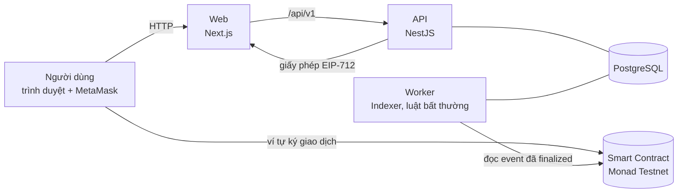

# Hộ chiếu số sản phẩm (Digital Product Passport)

Hệ thống theo dõi vòng đời, bảo hành và quyền sở hữu của từng sản phẩm. Mỗi sản phẩm có một "hộ chiếu số" và một mã QR riêng; các sự kiện quan trọng (phát hành, giao hàng, bán, sửa chữa, kiểm định, đổi chủ, thu hồi) do đúng đơn vị có thẩm quyền ghi lên blockchain **Monad Testnet** (chain ID `10143`). Ai cũng quét mã QR để xem lịch sử và tự đối chiếu với blockchain, không cần tin máy chủ của hệ thống.

Mô hình **Hybrid**: tài khoản đăng nhập bằng email và mật khẩu như web thông thường, còn mọi giao dịch on-chain do **chính ví MetaMask của người dùng** ký và trả gas. Hệ thống không giữ ví hay khoá của ai; backend chỉ ký giấy phép EIP-712 để contract kiểm tra quyền. Token MON chỉ dùng để kiểm thử, không có giá trị thương mại hay pháp lý.

- [Chức năng](#chức-năng)
- [Kiến trúc](#kiến-trúc)
- [Cài đặt từng bước](#cài-đặt-từng-bước)
- [Chạy với blockchain cục bộ](#chạy-với-blockchain-cục-bộ)
- [Kiểm thử](#kiểm-thử)
- [Lệnh thường dùng](#lệnh-thường-dùng)
- [Cấu trúc thư mục](#cấu-trúc-thư-mục)
- [Cơ sở dữ liệu](#cơ-sở-dữ-liệu)
- [Smart Contract trên Monad](#smart-contract-trên-monad)
- [Quy chuẩn lập trình](#quy-chuẩn-lập-trình)
- [Bảo mật](#bảo-mật)
- [Xử lý sự cố](#xử-lý-sự-cố)
- [Quy trình phát triển](#quy-trình-phát-triển)
- [Lịch sử phát triển](#lịch-sử-phát-triển)

## Chức năng

| Vai trò                 | Làm được gì                                                                                                                                                                                                                                                                                          | Trang                                                                               |
| ----------------------- | ---------------------------------------------------------------------------------------------------------------------------------------------------------------------------------------------------------------------------------------------------------------------------------------------------- | ----------------------------------------------------------------------------------- |
| Khách (không đăng nhập) | Tra cứu bằng mã 12 ký tự, camera hoặc ảnh tem QR. Xem hộ chiếu công khai: nhà phát hành, trạng thái, bảo hành, hành trình, kết quả kiểm định, cảnh báo thu hồi hoặc báo mất. Máy chủ đối chiếu sáu mục với contract; người xem bấm **Tự kiểm tra bằng trình duyệt** để trình duyệt tự đọc blockchain | `/lookup`, `/p/<mã>`                                                                |
| Người dùng              | Đăng ký, đăng nhập, liên kết và đổi ví MetaMask. Xem sản phẩm đã mua và hạn bảo hành; gửi yêu cầu bảo hành, kiểm định; chuyển nhượng cho người khác hoặc doanh nghiệp; báo mất, ngừng sử dụng; nhận thông báo                                                                                        | `/account`, `/owned`, `/transfers`, `/notifications`                                |
| Nhà sản xuất            | Nộp đơn doanh nghiệp kèm phí MON. Đăng ký sản phẩm từng cái hoặc theo file CSV (tối đa 50, một giao dịch); tải mã QR, in tem A4; gửi hàng cho nhà bán lẻ, huỷ khi gửi nhầm; gửi yêu cầu kiểm định; thu hồi theo lô kèm lý do công khai                                                               | `/organization`, `/products`                                                        |
| Nhà bán lẻ              | Nhận hoặc từ chối hàng gửi tới; bán cho tài khoản người mua, bảo hành kích hoạt ngay trong giao dịch bán                                                                                                                                                                                             | `/inventory`                                                                        |
| Trung tâm bảo hành      | Tiếp nhận yêu cầu và mở phiếu trên blockchain (bảo hành tạm dừng khi sửa); ghi biên bản kèm ảnh hoặc PDF, đóng phiếu bằng hash biên bản                                                                                                                                                              | `/service`                                                                          |
| Đơn vị kiểm định        | Ghi kết quả Đạt, Đạt có điều kiện hoặc Không đạt kèm hash biên bản; từ chối yêu cầu kèm lý do                                                                                                                                                                                                        | `/inspection`                                                                       |
| Quản trị viên           | Duyệt, từ chối, khoá doanh nghiệp; đổi phí đăng ký và ví Treasury; xem tổng quan hệ thống, cảnh báo bất thường, nhật ký kiểm toán, trạng thái CSDL, blockchain, Indexer                                                                                                                              | `/admin`, `/admin/organizations`, `/admin/alerts`, `/admin/audit`, `/system/status` |

Một tài khoản đại diện tối đa một doanh nghiệp; mục trên thanh đầu trang hiện theo đúng loại doanh nghiệp đã được duyệt. Hộ chiếu công khai không bao giờ hiện tên, email hay ví của người dùng cá nhân.

## Kiến trúc



| Thành phần           | Công nghệ                                      | Vai trò                                                                                                      |
| -------------------- | ---------------------------------------------- | ------------------------------------------------------------------------------------------------------------ |
| `apps/web`           | Next.js 16 (App Router), React 19, Tailwind 4  | Giao diện; gọi API, mở MetaMask để ký                                                                        |
| `apps/api`           | NestJS 12, Prisma 7, zod 4, ethers 6           | Modular Monolith 4 tầng, hai tiến trình từ cùng mã nguồn: API (HTTP) và Worker (Indexer, đối soát, luật nền) |
| `packages/contracts` | Solidity, Hardhat 3 + Ignition, OpenZeppelin 5 | 7 contract, deploy thành 6 bộ                                                                                |
| `packages/shared`    | TypeScript                                     | Enum, state machine, EIP-712, hash, ABI dùng chung cho API, Web và test contract                             |
| CSDL                 | PostgreSQL 17 (Docker)                         | Dữ liệu off-chain và bản chiếu của event on-chain                                                            |

Luồng ghi một sự kiện: web gửi yêu cầu → API kiểm tra nghiệp vụ, lưu hồ sơ và ký giấy phép EIP-712 → ví MetaMask của người dùng gửi giao dịch kèm giấy phép → contract kiểm tra quyền và phát event → Worker đọc event ở block đã finalized và chiếu vào CSDL đúng một lần.

| Contract               | Việc                                                                                   |
| ---------------------- | -------------------------------------------------------------------------------------- |
| `PartyRegistry`        | Định danh người dùng và doanh nghiệp, ví đại diện, đơn đăng ký, phí giữ trong contract |
| `ProductPassport`      | Hộ chiếu sản phẩm: hash hồ sơ, trạng thái, bên giữ hàng, chủ sở hữu                    |
| `WarrantyManager`      | Kích hoạt, tạm dừng, tiếp tục bảo hành theo lịch Việt Nam                              |
| `ServiceTicketManager` | Mở và đóng phiếu sửa chữa                                                              |
| `InspectionRegistry`   | Kết quả kiểm định và hash biên bản                                                     |
| `OwnershipTransfer`    | Yêu cầu chuyển nhượng: tạo, chấp nhận, từ chối, huỷ, hết hạn                           |
| `ProductLifecycle`     | Thu hồi theo lô, báo mất, ngừng sử dụng                                                |

## Cài đặt từng bước

Các lệnh dưới đây chạy trong **PowerShell** ở thư mục gốc dự án (macOS, Linux dùng lệnh tương đương, ví dụ `cp` thay cho `Copy-Item`).

### 1. Chuẩn bị công cụ

| Công cụ        | Phiên bản                | Ghi chú                                               |
| -------------- | ------------------------ | ----------------------------------------------------- |
| Node.js        | 22 LTS (tối thiểu 22.13) | Hardhat 3 yêu cầu ≥ 22.13                             |
| pnpm           | 10.x                     | Bật bằng `corepack enable`, không cần cài riêng       |
| Docker Desktop | bản mới                  | Chạy PostgreSQL 17                                    |
| Git            | bản mới                  |                                                       |
| MetaMask       | bản mới                  | Tiện ích cho Chrome hoặc Edge; chỉ dùng ví thử nghiệm |

```powershell
node -v          # v22.x
corepack enable
pnpm -v          # 10.x
docker -v
```

### 2. Lấy mã nguồn và cài thư viện

```powershell
git clone <url-repo> dpp
cd dpp
pnpm install     # bước postinstall tự build @dpp/shared và sinh Prisma Client
```

### 3. Tạo file `.env`

```powershell
Copy-Item .env.example .env
```

`.env` là file cấu hình duy nhất cho cả monorepo và **không bao giờ được commit** (đã có trong `.gitignore`). Ý nghĩa từng biến:

| Biến                                                                                    | Ý nghĩa                                                                                             | Cần làm                                        |
| --------------------------------------------------------------------------------------- | --------------------------------------------------------------------------------------------------- | ---------------------------------------------- |
| `POSTGRES_USER`, `POSTGRES_PASSWORD`, `POSTGRES_DB`, `POSTGRES_PORT`                    | Tài khoản và cổng của PostgreSQL trong Docker (cổng 5433 để không đụng PostgreSQL cài sẵn)          | Giữ mặc định                                   |
| `DATABASE_URL`, `TEST_DATABASE_URL`                                                     | Chuỗi kết nối tới CSDL `dpp` (chạy thật) và `dpp_test` (test e2e)                                   | Giữ mặc định; đổi cổng nếu đổi `POSTGRES_PORT` |
| `NODE_ENV`, `LOG_LEVEL`, `API_PORT`, `WEB_ORIGIN`                                       | Chế độ chạy, mức log, cổng API (4000), origin của web cho CORS                                      | Giữ mặc định                                   |
| `CHAIN_ID`, `RPC_URL`, `RPC_FALLBACK_URL`, `RPC_TIMEOUT_MS`                             | Mạng blockchain (10143 là Monad Testnet), RPC chính, RPC dự phòng, thời gian chờ RPC                | Giữ mặc định (đổi khi chạy Hardhat local)      |
| `JWT_SECRET`                                                                            | Khoá ký phiên đăng nhập                                                                             | Sinh ở bước 4                                  |
| `SESSION_TTL_MINUTES`                                                                   | Thời gian sống của phiên đăng nhập (phút)                                                           | Giữ mặc định                                   |
| `AUTH_RATE_LIMIT_PER_MINUTE`, `PUBLIC_RATE_LIMIT_PER_MINUTE`                            | Số lần đăng nhập, đăng ký mỗi phút mỗi IP (10); số lần gọi trang công khai mỗi phút mỗi IP (120)    | Giữ mặc định                                   |
| `REGISTRAR_SIGNER_PRIVATE_KEY`                                                          | Khoá backend dùng ký giấy phép EIP-712. Chỉ ký, không gửi giao dịch, không cần MON                  | Sinh ở bước 4                                  |
| `PARTY_REGISTRY_ADDRESS`, `PARTY_REGISTRY_DEPLOY_BLOCK`                                 | Địa chỉ PartyRegistry và block deploy (Indexer quét log từ block này)                               | Chép sau khi deploy ở bước 8                   |
| `PRODUCT_PASSPORT_ADDRESS`, `PRODUCT_PASSPORT_DEPLOY_BLOCK`, `WARRANTY_MANAGER_ADDRESS` | ProductPassport và WarrantyManager                                                                  | Chép sau khi deploy ở bước 8                   |
| `SERVICE_TICKET_MANAGER_ADDRESS`, `SERVICE_TICKET_MANAGER_DEPLOY_BLOCK`                 | ServiceTicketManager                                                                                | Chép sau khi deploy ở bước 8                   |
| `INSPECTION_REGISTRY_ADDRESS`, `INSPECTION_REGISTRY_DEPLOY_BLOCK`                       | InspectionRegistry                                                                                  | Chép sau khi deploy ở bước 8                   |
| `OWNERSHIP_TRANSFER_ADDRESS`, `OWNERSHIP_TRANSFER_DEPLOY_BLOCK`                         | OwnershipTransfer                                                                                   | Chép sau khi deploy ở bước 8                   |
| `PRODUCT_LIFECYCLE_ADDRESS`, `PRODUCT_LIFECYCLE_DEPLOY_BLOCK`                           | ProductLifecycle                                                                                    | Chép sau khi deploy ở bước 8                   |
| `UPLOAD_DIR`                                                                            | Thư mục lưu ảnh, PDF biên bản sửa chữa và kiểm định (tính từ `apps/api`, đã nằm trong `.gitignore`) | Giữ mặc định                                   |
| `PUBLIC_WEB_URL`                                                                        | Địa chỉ web in trong mã QR. Để trống thì dùng địa chỉ đang mở (localhost)                           | Để trống; đặt khi muốn quét bằng điện thoại    |
| `INDEXER_POLL_INTERVAL_MS`, `INDEXER_BLOCK_RANGE`                                       | Chu kỳ quét log (ms) và số block mỗi lần đọc log (RPC công khai của Monad giới hạn 100)             | Giữ mặc định                                   |
| `RECONCILE_INTERVAL_MINUTES`, `ANOMALY_SCAN_INTERVAL_MINUTES`                           | Chu kỳ đối soát ví với contract; chu kỳ Worker chạy luật phát hiện bất thường                       | Giữ mặc định                                   |
| `API_INTERNAL_URL`                                                                      | Địa chỉ Next.js chuyển tiếp `/api/v1` tới API                                                       | Giữ mặc định                                   |
| `MONAD_TESTNET_RPC_URL`                                                                 | RPC Hardhat dùng khi deploy; để trống thì dùng RPC công khai                                        | Để trống                                       |
| `DEPLOYER_PRIVATE_KEY`                                                                  | Khoá ví deploy. **Để trống**: khoá lưu trong keystore của Hardhat ở bước 7                          | Để trống                                       |
| `ETHERSCAN_API_KEY`, `SOLC_PATH`                                                        | Xác minh mã nguồn trên Monadscan; đường dẫn trình biên dịch Solidity khi mạng chặn tải              | Không bắt buộc                                 |

### 4. Sinh bí mật

```powershell
pnpm --filter @dpp/api secret:new       # in ra JWT_SECRET=...
pnpm --filter @dpp/api registrar:new    # in ra REGISTRAR_SIGNER_PRIVATE_KEY=... và địa chỉ registrar
```

Chép đúng hai dòng `JWT_SECRET=…` và `REGISTRAR_SIGNER_PRIVATE_KEY=…` vào `.env`, thay cho hai dòng trống có sẵn. Làm bước này **trước** khi deploy: lệnh deploy PartyRegistry đọc khoá registrar để cấp quyền ký giấy phép.

### 5. Bật cơ sở dữ liệu

```powershell
pnpm db:up                                 # PostgreSQL 17 trong Docker, tự tạo CSDL dpp và dpp_test
pnpm db:deploy                             # áp migration vào dpp
pnpm --filter @dpp/api db:deploy:test      # áp migration vào dpp_test
```

### 6. Biên dịch và test Smart Contract

```powershell
pnpm contracts:compile
pnpm contracts:test
```

### 7. Chuẩn bị ví deploy

Ví deploy là ví **Admin** của hệ thống (có quyền duyệt doanh nghiệp) và mặc định là ví **Treasury** nhận phí đăng ký.

1. Trong MetaMask, tạo một tài khoản riêng làm ví deploy (chỉ dùng ví thử nghiệm).
2. Nhận MON testnet ở https://faucet.monad.xyz. Ví deploy cần khoảng 2 MON cho 6 lần deploy (tổng khoảng 10 triệu gas), cộng số MON muốn chia cho các ví kiểm thử.
3. Lấy khoá riêng của ví này trong MetaMask (**Chi tiết tài khoản → Hiện khoá riêng tư**, bản tiếng Anh: Account details → Show private key), rồi lưu vào keystore mã hoá của Hardhat:

   ```powershell
   pnpm --filter @dpp/contracts exec hardhat keystore set DEPLOYER_PRIVATE_KEY
   ```

   Lần đầu Hardhat hỏi mật khẩu để tạo keystore, sau đó hỏi giá trị khoá. Khoá chỉ nằm trong keystore, không nằm trong `.env` hay repo. Không gửi khoá riêng cho ai qua chat hay email.

### 8. Deploy 6 bộ contract lên Monad Testnet

Chạy lần lượt theo đúng thứ tự (bộ sau đọc địa chỉ của bộ trước trong `.env`). Mỗi lệnh hỏi mật khẩu keystore, rồi in các dòng `TEN_BIEN=giá_trị` dưới chữ "Chép vào .env": chép vào `.env` **trước khi** chạy lệnh tiếp theo.

| #   | Lệnh                                                    | Deploy                           | Chép vào `.env`                                                                         |
| --- | ------------------------------------------------------- | -------------------------------- | --------------------------------------------------------------------------------------- |
| 8.1 | `pnpm --filter @dpp/contracts deploy:monad`             | PartyRegistry                    | `PARTY_REGISTRY_ADDRESS`, `PARTY_REGISTRY_DEPLOY_BLOCK`                                 |
| 8.2 | `pnpm --filter @dpp/contracts deploy:products:monad`    | ProductPassport, WarrantyManager | `PRODUCT_PASSPORT_ADDRESS`, `PRODUCT_PASSPORT_DEPLOY_BLOCK`, `WARRANTY_MANAGER_ADDRESS` |
| 8.3 | `pnpm --filter @dpp/contracts deploy:services:monad`    | ServiceTicketManager             | `SERVICE_TICKET_MANAGER_ADDRESS`, `SERVICE_TICKET_MANAGER_DEPLOY_BLOCK`                 |
| 8.4 | `pnpm --filter @dpp/contracts deploy:inspections:monad` | InspectionRegistry               | `INSPECTION_REGISTRY_ADDRESS`, `INSPECTION_REGISTRY_DEPLOY_BLOCK`                       |
| 8.5 | `pnpm --filter @dpp/contracts deploy:transfers:monad`   | OwnershipTransfer                | `OWNERSHIP_TRANSFER_ADDRESS`, `OWNERSHIP_TRANSFER_DEPLOY_BLOCK`                         |
| 8.6 | `pnpm --filter @dpp/contracts deploy:lifecycle:monad`   | ProductLifecycle                 | `PRODUCT_LIFECYCLE_ADDRESS`, `PRODUCT_LIFECYCLE_DEPLOY_BLOCK`                           |

Các script tự kiểm tra contract trước đã có trên chain, ví deploy còn quyền Admin, rồi cấp role cần thiết giữa các contract.

Thư mục `packages/contracts/ignition/deployments/chain-10143*` lưu bản deploy của nhóm. Trên máy đã deploy, chạy lại một lệnh deploy chỉ in lại địa chỉ cũ; khi đó **giữ nguyên** block deploy cũ trong `.env` (block in ra lúc này là block hiện tại). Máy mới muốn deploy bộ contract riêng (ví dụ giảng viên chạy bằng ví của mình) thì xoá các thư mục đó trên máy mình trước khi deploy, và không commit việc xoá:

```powershell
Remove-Item -Recurse -Force packages/contracts/ignition/deployments/chain-10143*
```

### 9. Chạy hệ thống

```powershell
pnpm dev
```

Lệnh chạy cùng lúc API (cổng 4000), Worker và Web (cổng 3000). Đợi log "API đang chạy tại http://localhost:4000/api/v1" và "Worker đã sẵn sàng trên Monad Testnet", rồi mở:

- http://localhost:3000: trang tổng quan.
- http://localhost:3000/system/status: CSDL, Blockchain, Indexer phải cùng **Hoạt động**.

### 10. Thêm Monad Testnet vào MetaMask

Web tự đề nghị thêm và chuyển mạng ở lần liên kết ví đầu tiên. Muốn thêm tay: MetaMask → **Mạng → Thêm mạng → Thêm mạng thủ công**:

| Ô                  | Giá trị                           |
| ------------------ | --------------------------------- |
| Tên mạng           | `Monad Testnet`                   |
| URL RPC            | `https://testnet-rpc.monad.xyz`   |
| Chain ID           | `10143`                           |
| Ký hiệu tiền tệ    | `MON`                             |
| URL block explorer | `https://testnet.monadvision.com` |

MON testnet nhận ở https://faucet.monad.xyz, hoặc chuyển từ ví deploy sang ví khác bằng nút **Gửi** của MetaMask.

### 11. Tạo tài khoản Admin

1. Trên web, bấm **Tạo tài khoản** để đăng ký tài khoản sẽ làm Admin.
2. Cấp quyền (mở cửa sổ PowerShell thứ hai, giữ `pnpm dev` chạy):

   ```powershell
   pnpm --filter @dpp/api admin:grant <email-admin>
   ```

3. Đăng nhập tài khoản đó → **Tài khoản** → trong MetaMask chọn **đúng ví deploy** → **Liên kết MetaMask**, ký thông điệp rồi ký giao dịch. Thanh đầu trang có thêm mục **Quản trị**.

Muốn Admin dùng một ví khác ví deploy thì cho ví deploy cấp quyền thay vì deploy lại: `$env:NEW_ADMIN_WALLET="0x..."` rồi `pnpm --filter @dpp/contracts admin-role:monad`. Ví Treasury đổi được ở **Quản trị → Doanh nghiệp**.

### 12. Kiểm thử toàn hệ thống

Làm theo [docs/kich-ban-kiem-thu.md](docs/kich-ban-kiem-thu.md): từng bước ghi rõ tài khoản, ví, giá trị cần dán (có sẵn ở [docs/du-lieu-mau/thong-tin-mau.md](docs/du-lieu-mau/thong-tin-mau.md)), nút cần bấm và kết quả đúng.

### Quét mã QR bằng điện thoại

`pnpm dev` in ra dòng `Network: http://192.168.x.x:3000`. Đặt `PUBLIC_WEB_URL` bằng địa chỉ đó trong `.env`, khởi động lại `pnpm dev`, cho phép Node.js qua tường lửa Windows (mạng Private). Điện thoại cùng Wi-Fi quét tem bằng ứng dụng camera là mở đúng hộ chiếu. Nút **Quét bằng camera** trên web chỉ dùng được ở `localhost` hoặc HTTPS, vì trình duyệt chặn camera trên địa chỉ khác.

## Chạy với blockchain cục bộ

Dùng Hardhat node (chain ID `31337`) khi không có Internet, không muốn tốn MON, hoặc để demo. Dữ liệu mất khi tắt node.

1. Cửa sổ 1, để mở suốt buổi:

   ```powershell
   pnpm --filter @dpp/contracts node
   ```

2. Giữ cấu hình Monad để quay lại sau: `Copy-Item .env .env.monad` (các file `.env.*` không bị commit). Sửa `.env`: `CHAIN_ID=31337`, `RPC_URL=http://127.0.0.1:8545`, `RPC_FALLBACK_URL=` (để trống).
3. Cửa sổ 2, chạy lần lượt và chép các dòng in ra vào `.env` như bước 8 (ví deploy là tài khoản #0 của Hardhat node, không cần keystore):

   ```powershell
   pnpm --filter @dpp/contracts deploy:local
   pnpm --filter @dpp/contracts deploy:products:local
   pnpm --filter @dpp/contracts deploy:services:local
   pnpm --filter @dpp/contracts deploy:inspections:local
   pnpm --filter @dpp/contracts deploy:transfers:local
   pnpm --filter @dpp/contracts deploy:lifecycle:local
   ```

4. Làm mới CSDL (mốc quét của Indexer phải bắt đầu từ chain mới), rồi chạy:

   ```powershell
   pnpm --filter @dpp/api db:reset
   pnpm dev
   ```

5. Trong MetaMask, thêm mạng RPC `http://127.0.0.1:8545`, chain ID `31337`, ký hiệu `ETH`, rồi import các tài khoản thử mà Hardhat node in ra khi khởi động (khoá công khai, **chỉ dùng cục bộ**).

Mỗi lần khởi động lại Hardhat node phải làm lại bước 3–4, và trong MetaMask xoá lịch sử giao dịch của từng tài khoản (**Cài đặt → Nâng cao → Xoá dữ liệu thẻ hoạt động**, bản tiếng Anh: Settings → Advanced → Clear activity tab data) để không lệch nonce. Kịch bản demo trên Hardhat local có lệnh dựng sẵn dữ liệu: [docs/demo-kich-ban.md](docs/demo-kich-ban.md).

## Kiểm thử

Cần PostgreSQL đang chạy (`pnpm db:up`).

```powershell
pnpm format:check
pnpm lint
pnpm typecheck
pnpm test        # 459 test unit và contract
pnpm test:e2e    # 128 test e2e: tự bật Hardhat node riêng, chạy trên CSDL dpp_test
pnpm build
```

CI trên GitHub Actions chạy lại đủ các bước này sau mỗi lần push. Test e2e đi trọn luồng thật: API → giấy phép → ví ký giao dịch trên Hardhat node → event → Indexer → CSDL.

| Tài liệu                                                           | Nội dung                                                                  |
| ------------------------------------------------------------------ | ------------------------------------------------------------------------- |
| [docs/kich-ban-kiem-thu.md](docs/kich-ban-kiem-thu.md)             | Kiểm thử tay toàn hệ thống trên web, kèm [dữ liệu mẫu](docs/du-lieu-mau/) |
| [docs/demo-kich-ban.md](docs/demo-kich-ban.md)                     | Demo 13 bước khi báo cáo                                                  |
| [docs/m13-benchmark-hardening.md](docs/m13-benchmark-hardening.md) | Đo hiệu năng, kiểm thử độ bền, ánh xạ ca kiểm thử sang test tự động       |

Các test chứng minh chuỗi `CSDL ↔ shared ↔ Solidity ↔ Web` luôn khớp nhau:

| Test                                                        | Chứng minh                                                                               |
| ----------------------------------------------------------- | ---------------------------------------------------------------------------------------- |
| `apps/api/src/infrastructure/database/prisma-enums.spec.ts` | Enum PostgreSQL trùng tên và thứ tự với `@dpp/shared`                                    |
| `packages/contracts/test/shared/dpp-types.test.ts`          | Enum và role trong Solidity trùng với `@dpp/shared`                                      |
| `packages/contracts/test/shared/abi-export.test.ts`         | ABI dùng ở API, Web trùng contract đã biên dịch                                          |
| `apps/api/test/database/schema-constraints.e2e-spec.ts`     | Từng ràng buộc CSDL chặn đúng dữ liệu sai                                                |
| `apps/api/test/identity/auth.e2e-spec.ts`                   | Đăng ký, đăng nhập: Argon2id, cookie, phiên, CSRF                                        |
| `apps/api/test/identity/wallet-link.e2e-spec.ts`            | Liên kết và đổi ví trên Hardhat node                                                     |
| `apps/api/test/chain-sync/indexer.e2e-spec.ts`              | Indexer chiếu event đúng một lần, đối soát tạo cảnh báo                                  |
| `apps/api/test/organizations/organizations.e2e-spec.ts`     | Nộp đơn → từ chối → rút phí → nộp lại → duyệt (Treasury nhận đúng phí), khoá, đổi phí    |
| `apps/api/test/products/products.e2e-spec.ts`               | Đăng ký sản phẩm, lô CSV, tra cứu công khai đọc lại contract                             |
| `apps/api/test/products/distribution.e2e-spec.ts`           | Gửi, từ chối, huỷ, nhận, bán, bảo hành; hộ chiếu không lộ người mua                      |
| `apps/api/test/service/service.e2e-spec.ts`                 | Phiếu sửa chữa, biên bản kèm ảnh khớp hash, sửa biên bản thì lệch                        |
| `apps/api/test/inspection/inspection.e2e-spec.ts`           | Kiểm định: gửi, huỷ, từ chối, ghi kết quả, công khai, cảnh báo                           |
| `apps/api/test/transfer/transfer.e2e-spec.ts`               | Chuyển nhượng: đổi chủ, bảo hành đi theo, phiếu sửa chặn, quá hạn                        |
| `apps/api/test/lifecycle/lifecycle.e2e-spec.ts`             | Thu hồi theo lô, báo mất, ngừng sử dụng, thông báo; quét lại từ block deploy không trùng |
| `apps/api/test/verification/verification.e2e-spec.ts`       | Đối chiếu công khai: khớp, đang cập nhật, lệch và cảnh báo, ẩn người mua                 |
| `apps/api/test/verification/public-rate-limit.e2e-spec.ts`  | Giới hạn lượt tra cứu theo IP                                                            |
| `apps/api/test/monitoring/monitoring.e2e-spec.ts`           | Luật bất thường không tạo trùng, chốt cảnh báo kèm ghi chú, lọc nhật ký, tổng quan       |
| `apps/api/test/hardening/reorg.e2e-spec.ts`                 | Reorg ở block chưa finalized: event ORPHANED, không chiếu; gửi lại thì chốt một lần      |
| `packages/contracts/test/**`                                | Mỗi contract: luồng đúng và mọi điều kiện revert                                         |

## Lệnh thường dùng

| Lệnh                                             | Việc làm                                                                 |
| ------------------------------------------------ | ------------------------------------------------------------------------ |
| `pnpm dev`                                       | Chạy API, Worker, Web cùng lúc, tự tải lại khi sửa mã                    |
| `pnpm build`                                     | Build toàn bộ theo đúng thứ tự phụ thuộc                                 |
| `pnpm lint` / `pnpm typecheck`                   | Kiểm tra lint (oxlint, ESLint) và kiểu                                   |
| `pnpm test` / `pnpm test:e2e`                    | Test unit và contract / test e2e trên CSDL `dpp_test`                    |
| `pnpm format` / `pnpm format:check`              | Định dạng mã bằng Prettier                                               |
| `pnpm db:up` / `pnpm db:down`                    | Bật / tắt PostgreSQL trong Docker                                        |
| `pnpm db:migrate` / `pnpm db:deploy`             | Tạo migration khi phát triển / áp migration có sẵn                       |
| `pnpm db:studio`                                 | Mở Prisma Studio xem và sửa dữ liệu                                      |
| `pnpm --filter @dpp/api db:reset`                | Xoá sạch CSDL `dpp` và áp lại migration                                  |
| `pnpm contracts:compile` / `pnpm contracts:test` | Biên dịch / test Smart Contract                                          |
| `pnpm --filter @dpp/contracts deploy:<bộ>:monad` | Deploy một bộ contract (xem bước 8; `:local` cho Hardhat node)           |
| `pnpm --filter @dpp/contracts admin-role:monad`  | Ví deploy cấp quyền Admin PartyRegistry cho ví trong `NEW_ADMIN_WALLET`  |
| `pnpm --filter @dpp/contracts abi:export`        | Sinh lại ABI vào `packages/shared/src/abi` sau khi sửa contract          |
| `pnpm --filter @dpp/api secret:new`              | Sinh `JWT_SECRET`                                                        |
| `pnpm --filter @dpp/api registrar:new`           | Sinh khoá ký giấy phép `REGISTRAR_SIGNER_PRIVATE_KEY`                    |
| `pnpm --filter @dpp/api admin:grant <email>`     | Cấp quyền Admin cho tài khoản (`admin:revoke` để thu lại)                |
| `pnpm --filter @dpp/contracts bench:local`       | Đo gas, phí, độ trễ trên Hardhat node (`bench:monad` cho testnet)        |
| `pnpm --filter @dpp/api bench:baseline`          | Đo đường cơ sở PostgreSQL + chữ ký ECDSA để so với blockchain            |
| `pnpm --filter @dpp/api demo:seed`               | Dựng bước 1–6 của kịch bản demo trên Hardhat local (cần `DEMO_PASSWORD`) |
| `pnpm --filter @dpp/api demo:reverts <mã>`       | Gọi thử cho thấy contract từ chối ở bước 9, 11, 12 của kịch bản demo     |

## Cấu trúc thư mục

```text
dpp/
├── apps/
│   ├── api/                          # NestJS, Modular Monolith
│   │   ├── prisma/                   # schema.prisma (23 bảng), migrations/ (kèm CHECK, trigger)
│   │   ├── scripts/                  # sinh bí mật, cấp quyền Admin, đo hiệu năng, dữ liệu demo
│   │   ├── src/
│   │   │   ├── main.ts               # tiến trình API (HTTP)
│   │   │   ├── worker.ts             # tiến trình Worker (Indexer, đối soát, luật bất thường)
│   │   │   ├── config/               # nạp và kiểm tra .env bằng zod
│   │   │   ├── common/               # lỗi chung, pipe zod, giới hạn lượt gọi, kiểm tra file biên bản
│   │   │   ├── infrastructure/       # Prisma, JSON-RPC có dự phòng, lưu file
│   │   │   └── modules/              # identity, chain-sync, organizations, products, service,
│   │   │                             # inspection, transfer, lifecycle, notifications,
│   │   │                             # verification, monitoring, audit, health
│   │   └── test/                     # e2e theo từng module, chạy trên Hardhat node thật
│   └── web/                          # Next.js
│       └── src/
│           ├── app/                  # các trang (route)
│           ├── components/           # ui/ dùng chung, layout/
│           ├── features/             # theo tính năng: auth, wallet-link, products, distribution, ...
│           ├── lib/                  # định dạng, nhãn trạng thái, wallet/ (MetaMask)
│           └── proxy.ts              # chuyển IP thật của người dùng sang API
├── packages/
│   ├── contracts/                    # Hardhat 3 + OpenZeppelin 5
│   │   ├── contracts/                # registry/, product/, warranty/, service/, inspection/,
│   │   │                             # transfer/, lifecycle/, shared/ (kiểu, role, lỗi, lịch Việt Nam)
│   │   ├── ignition/                 # module deploy và bản deploy của nhóm trên Monad
│   │   ├── scripts/                  # deploy-*.ts, grant-admin-role.ts, export-abi.ts, benchmark.ts
│   │   └── test/
│   └── shared/src/                   # abi/, chain/ (mạng, EIP-712), domain/ (enum, state machine, hash), api/
├── docs/                             # thiết kế từng module, kịch bản kiểm thử, dữ liệu mẫu, demo, benchmark
├── docker/postgres/init/             # tạo CSDL dpp_test lần đầu
├── docker-compose.yml
├── .env.example
└── .github/workflows/ci.yml          # format, lint, typecheck, test, e2e, build
```

Quy tắc phân tầng của mỗi module API (bắt buộc):

1. Phụ thuộc chỉ đi một chiều `presentation → application → domain`; `infrastructure` hiện thực các port do `application` khai báo.
2. Module khác chỉ import qua `index.ts` của module, không đọc ghi bảng của module khác.
3. Mỗi module sở hữu bảng của mình và projector cho event thuộc nó.
4. `packages/shared` không phụ thuộc NestJS, Next.js hay Prisma.

## Cơ sở dữ liệu

| Ký hiệu | Ý nghĩa                 | Ai được ghi          | Ví dụ                                            |
| ------- | ----------------------- | -------------------- | ------------------------------------------------ |
| [A]     | Off-chain authoritative | API                  | users, audit_logs, chain_transactions            |
| [P]     | On-chain projection     | Chỉ Worker (Indexer) | transfer_requests, warranties, ownership_records |
| [A+P]   | Có cả hai nhóm cột      | Theo từng cột        | products, organizations, service_requests        |
| [R]     | Raw event cache         | Chỉ Worker (Indexer) | blockchain_events, indexer_checkpoints           |

Mỗi model trong `apps/api/prisma/schema.prisma` ghi rõ loại và các cột [P]. Ràng buộc chính, đều có test e2e chứng minh:

| Ràng buộc                         | Ý nghĩa                                                    |
| --------------------------------- | ---------------------------------------------------------- |
| `ck_parties_subject`              | Party trỏ tới đúng một User hoặc một Organization          |
| `ck_products_owner_matches_state` | Chưa bán thì chưa có chủ; đã bán thì bắt buộc có chủ       |
| `ck_products_pending_custodian`   | Chỉ khi đang vận chuyển mới có bên nhận đang chờ           |
| `ux_transfer_one_active`          | Mỗi sản phẩm tối đa 1 yêu cầu chuyển nhượng đang mở        |
| `ux_service_one_open`             | Mỗi sản phẩm tối đa 1 phiếu sửa chữa đang mở               |
| `ux_wallet_one_active_personal`   | Mỗi người dùng chỉ 1 ví cá nhân đang dùng                  |
| `ux_wallet_one_pending_personal`  | Mỗi người dùng chỉ 1 yêu cầu liên kết ví đang chờ          |
| `organizations_representative_*`  | Mỗi tài khoản đại diện tối đa 1 doanh nghiệp               |
| `ux_org_application_one_pending`  | Mỗi doanh nghiệp tối đa 1 lần nộp đơn đang chờ duyệt       |
| `products_issuer_org_id_serial_*` | Serial duy nhất trong một nhà sản xuất                     |
| `ck_products_serial_pattern`      | Serial in hoa, chỉ gồm chữ, số và `. _ / -`                |
| `ck_products_public_code_format`  | Mã tra cứu đúng 12 ký tự, không có I, O, 0, 1              |
| `ck_products_warranty_months_*`   | Bảo hành 0–120 tháng; ngày sản xuất từ 1990                |
| `ux_blockchain_events_identity`   | Event ghi idempotent theo (chain_id, tx_hash, log_index)   |
| `ck_blockchain_events_finality`   | FINALIZED phải có thời điểm, không bao giờ thành ORPHANED  |
| `ck_users_password_hash_argon2id` | Mật khẩu lưu dạng băm Argon2id                             |
| `trg_audit_logs_append_only`      | `audit_logs` không cho UPDATE, DELETE                      |
| Địa chỉ, hash                     | Lưu chữ thường, đúng 42/66 ký tự hex                       |
| Khoá ngoại                        | `ON DELETE RESTRICT`, không xoá dây chuyền dữ liệu lịch sử |

Thêm migration mới:

```powershell
# 1. Sửa apps/api/prisma/schema.prisma
# 2. Sinh migration nhưng chưa áp dụng
pnpm --filter @dpp/api exec prisma migrate dev --create-only --name ten_thay_doi
# 3. Thêm CHECK, trigger (nếu có) vào cuối file migration.sql vừa sinh
# 4. Áp dụng
pnpm db:migrate
```

CHECK constraint và trigger viết tay trong migration vì Prisma schema không mô tả được; Prisma Migrate không xoá chúng ở các lần sau. Partial unique index khai báo ngay trong schema (preview feature `partialIndexes`); điều kiện viết bằng `raw(...)` phải đúng dạng PostgreSQL chuẩn hoá (ví dụ `service_state = ANY (ARRAY[...])`), nếu không Prisma sẽ sinh migration thừa.

## Smart Contract trên Monad

- Mạng `monadTestnet` trong `packages/contracts/hardhat.config.ts`: chain ID 10143, RPC mặc định `https://testnet-rpc.monad.xyz` (đổi bằng `MONAD_TESTNET_RPC_URL`).
- Sau khi sửa contract: `pnpm --filter @dpp/contracts abi:export` để cập nhật ABI trong `@dpp/shared` (test báo đỏ nếu quên).
- Xác minh mã nguồn: `pnpm --filter @dpp/contracts exec hardhat verify <địa_chỉ> --network monadTestnet`. Sourcify của MonadVision không cần API key; Monadscan cần `ETHERSCAN_API_KEY`.
- Mạng chặn tải trình biên dịch Solidity thì đặt `SOLC_PATH` tới `soljson.js` (gói npm `solc`) hoặc file solc native.

Ba điểm Monad khác Ethereum mà hệ thống đã tính tới:

1. Phí gas tính theo **gas limit**, không phải gas đã dùng, nên backend đặt gas limit sát ước lượng.
2. Block finalized sau 2 block và không reorg được nữa; Indexer chỉ chiếu event sang CSDL khi block đã finalized. RPC công khai giới hạn `eth_getLogs` 100 block mỗi lần.
3. Mỗi ví có **số dư dự trữ** 10 MON: giao dịch chuyển MON (ví dụ nộp phí đăng ký) làm số dư xuống dưới 10 MON sẽ bị revert, trừ khi đó là giao dịch đầu tiên của ví trong 3 block gần nhất. Người bấm tay hầu như luôn thoả điều kiện này; nếu nộp phí bị revert thì đợi vài giây rồi nộp lại.

## Quy chuẩn lập trình

| Hạng mục         | Quy ước                                                                                      |
| ---------------- | -------------------------------------------------------------------------------------------- |
| Tên file TS/TSX  | `kebab-case`, ví dụ `product-passport.service.ts` (oxlint kiểm tra)                          |
| Biến, hàm        | `camelCase`                                                                                  |
| Class, interface | `PascalCase`                                                                                 |
| Hằng số          | `UPPER_SNAKE_CASE`, ví dụ `MONAD_TESTNET`, `MANUFACTURER_ROLE`                               |
| Enum             | Object hằng `PascalCase` kèm kiểu cùng tên (`ProductState`), không dùng `enum` của TS        |
| File Solidity    | `PascalCase.sol` theo Solidity Style Guide (trùng tên contract)                              |
| Comment          | JSDoc ngắn trên hàm chính; comment inline chỉ cho logic phức tạp                             |
| Giao diện        | Tối giản, xanh đại dương đậm và xám lạnh, không gradient, dùng token màu trong `globals.css` |

`apps/api` tắt rule `consistent-type-imports` vì NestJS cần import giá trị (không phải `import type`) cho class được inject qua constructor.

## Bảo mật

- **Không commit `.env`** và không gửi nội dung của nó cho ai. Khoá ví deploy nằm trong keystore mã hoá của Hardhat, không nằm trong `.env`. Chỉ dùng ví thử nghiệm cho dự án.
- Hệ thống không giữ khoá của người dùng hay doanh nghiệp: mọi giao dịch do ví MetaMask của chính họ ký. Khoá registrar của backend chỉ ký giấy phép EIP-712 có hạn dùng, không gửi giao dịch và không giữ MON.
- Mật khẩu băm Argon2id; phiên đăng nhập là JWT trong cookie httpOnly, đăng xuất thu hồi mọi phiên cũ; chặn CSRF theo Origin; giới hạn số lần đăng nhập và tra cứu theo IP.
- Lên blockchain chỉ có hash hồ sơ, hash biên bản và mã định danh, không có tên, email hay mô tả lỗi. Hộ chiếu công khai ẩn mọi thông tin của người dùng cá nhân.
- `audit_logs` chỉ ghi thêm (trigger chặn sửa, xoá). Worker cảnh báo Admin khi dữ liệu CSDL lệch blockchain, giao dịch treo, đăng nhập sai dồn dập và các bất thường khác.

## Xử lý sự cố

| Hiện tượng                                                      | Cách xử lý                                                                                                                                                                                                                        |
| --------------------------------------------------------------- | --------------------------------------------------------------------------------------------------------------------------------------------------------------------------------------------------------------------------------- |
| Cổng 5433 đã bị chiếm                                           | Đổi `POSTGRES_PORT` và cổng trong `DATABASE_URL`, `TEST_DATABASE_URL`                                                                                                                                                             |
| `P1000` khi `pnpm db:deploy`                                    | Tên user trong lỗi khác `POSTGRES_USER`: biến môi trường Windows `DATABASE_URL` đang được ưu tiên hơn `.env`, hoặc `.env` ghi sai. User đúng mà vẫn lỗi: cổng đang trỏ vào PostgreSQL cài sẵn trên máy (`Get-Service *postgres*`) |
| Đổi `POSTGRES_*` sau khi đã `db:up`, hoặc thiếu CSDL `dpp_test` | Container chỉ tạo user và CSDL lúc khởi tạo volume: `docker compose down -v` rồi `pnpm db:up`                                                                                                                                     |
| API báo `Cấu hình môi trường không hợp lệ`                      | Thông báo liệt kê đúng biến sai; đối chiếu với `.env.example`                                                                                                                                                                     |
| API dừng với `ChainMismatchError`                               | `RPC_URL` trỏ sai mạng so với `CHAIN_ID`; sửa cho khớp                                                                                                                                                                            |
| Trang trạng thái báo không kết nối được API                     | Chạy `pnpm dev`, kiểm tra `API_INTERNAL_URL`                                                                                                                                                                                      |
| `prisma generate` lỗi tải engine                                | Máy cần truy cập `binaries.prisma.sh` ở lần cài đầu; thử lại khi có mạng                                                                                                                                                          |
| Trang báo chưa cấu hình một contract                            | Thiếu địa chỉ tương ứng trong `.env`: chạy lệnh deploy của bộ đó (bước 8), chép các dòng in ra, khởi động lại `pnpm dev`                                                                                                          |
| Deploy báo `HHE10120 ... reconciliation errors`                 | Đang dùng lại bản deploy của nhóm với tham số khác (ví dụ khoá registrar khác). Deploy bộ riêng theo ghi chú ở bước 8                                                                                                             |
| Deploy báo ví deploy không có quyền Admin                       | Ví trong keystore không phải ví đã deploy PartyRegistry. Dùng đúng ví đó                                                                                                                                                          |
| Trạng thái hệ thống báo Indexer chưa quét hoặc chậm             | Worker chưa chạy hoặc đang bắt kịp từ block deploy; xem log Worker. Chậm lâu thì kiểm tra các `*_DEPLOY_BLOCK` và RPC                                                                                                             |
| Mở `/admin` ra trang 404                                        | Tài khoản chưa có quyền Admin: `pnpm --filter @dpp/api admin:grant <email>` rồi tải lại trang                                                                                                                                     |
| Quản trị báo ví đang liên kết không có quyền Admin              | Ví của tài khoản Admin khác ví deploy: cấp quyền bằng `admin-role:monad` (bước 11)                                                                                                                                                |
| Web báo "MetaMask đang chọn ví khác"                            | Chọn trong MetaMask đúng ví đã liên kết với tài khoản đang đăng nhập rồi bấm lại                                                                                                                                                  |
| Liên kết ví báo "Ví này đã từng được liên kết trong hệ thống"   | Mỗi ví chỉ liên kết được một lần. Tạo tài khoản MetaMask mới cho tài khoản này                                                                                                                                                    |
| Nộp đơn báo "Phí đăng ký vừa được thay đổi"                     | Admin vừa đổi phí; tải lại trang Doanh nghiệp rồi nộp lại                                                                                                                                                                         |
| Nộp phí bị revert dù đủ MON                                     | Số dư dự trữ 10 MON của Monad (mục Smart Contract trên Monad): đợi vài giây rồi nộp lại                                                                                                                                           |
| Ví báo không đủ MON trả gas                                     | Nhận MON ở https://faucet.monad.xyz hoặc chuyển từ ví khác                                                                                                                                                                        |
| Không thấy mục Sản phẩm, Kho hàng, Bảo hành, Kiểm định          | Mục chỉ hiện với người đại diện đúng loại doanh nghiệp đã được Admin duyệt                                                                                                                                                        |
| Khung Phân phối báo chưa có nhà bán lẻ                          | Chưa có doanh nghiệp loại Nhà bán lẻ nào được duyệt                                                                                                                                                                               |
| Bán hàng báo không có tài khoản với email này                   | Người mua tạo tài khoản ở trang Đăng ký trước (chưa cần ví), rồi nhập đúng email đó                                                                                                                                               |
| Nhập CSV báo thiếu cột                                          | Dùng nút **Tải file mẫu**; Excel lưu dạng "CSV UTF-8" để giữ dấu tiếng Việt                                                                                                                                                       |
| Hộ chiếu báo "Bạn tra cứu quá nhanh"                            | Một IP mở quá `PUBLIC_RATE_LIMIT_PER_MINUTE` lượt mỗi phút (mỗi lần mở hộ chiếu tốn 4 lượt). Đợi một phút, hoặc tăng giá trị rồi khởi động lại `pnpm dev`                                                                         |
| "Tự kiểm tra bằng trình duyệt" báo không đọc được blockchain    | Mạng hoặc tiện ích chặn quảng cáo chặn RPC Monad. Tắt tiện ích chặn, hoặc mở MetaMask ở Monad Testnet rồi bấm lại                                                                                                                 |
| Điện thoại quét QR không mở được trang                          | QR đang chứa `localhost`: đặt `PUBLIC_WEB_URL` (mục Quét mã QR bằng điện thoại)                                                                                                                                                   |
| MetaMask báo lỗi nonce sau khi khởi động lại Hardhat node       | MetaMask → Cài đặt → Nâng cao → Xoá dữ liệu thẻ hoạt động, rồi deploy lại contract                                                                                                                                                |
| Worker báo block finalized thấp hơn mốc đã quét                 | Thường do vừa khởi động lại Hardhat node: `pnpm --filter @dpp/api db:reset` rồi deploy lại contract                                                                                                                               |
| Test e2e báo "Chưa biên dịch contract"                          | Chạy `pnpm contracts:compile` trước `pnpm test:e2e`                                                                                                                                                                               |

## Quy trình phát triển

- Nhóm phát triển theo 13 module (M1 → M13). Mỗi module có tài liệu trong `docs/` ghi lại quyết định thiết kế (D14–D104), luồng nghiệp vụ, API, bảng truy vết, gas và test chứng minh.
- Nhóm sử dụng trợ lý AI (Claude) để **hỗ trợ** viết mã, test và tài liệu. Nhóm chịu trách nhiệm phân tích nghiệp vụ, chọn phương án thiết kế, đọc hiểu và chỉnh sửa mã, chạy kiểm thử, deploy và vận hành hệ thống trên Monad Testnet.
- Trước khi push lên `main`, nhóm chạy đủ format, lint, typecheck, test, e2e, build trên máy; CI trên GitHub chạy lại các bước này sau mỗi lần push.

## Lịch sử phát triển

| Module | Nội dung                                                                             | Tài liệu                                                      |
| ------ | ------------------------------------------------------------------------------------ | ------------------------------------------------------------- |
| M0     | Thiết kế chuẩn hoá, bảng traceability                                                | Tài liệu phân tích                                            |
| M1     | Monorepo, CSDL và ràng buộc, API + Worker, cấu hình Hardhat cho Monad, giao diện nền |                                                               |
| M2     | Tài khoản, đăng nhập, liên kết và đổi ví MetaMask, PartyRegistry                     | [m2-identity-auth.md](docs/m2-identity-auth.md)               |
| M3     | Indexer quét log theo block finalized, đối soát ví                                   | [m3-indexer.md](docs/m3-indexer.md)                           |
| M4     | Doanh nghiệp, phí MON giữ trong contract, duyệt, từ chối, rút phí, khoá              | [m4-organizations.md](docs/m4-organizations.md)               |
| M5     | Sản phẩm, nhập CSV, mã QR, in tem, tra cứu công khai                                 | [m5-products.md](docs/m5-products.md)                         |
| M6     | Gửi hàng, nhận hàng, bán, kích hoạt bảo hành                                         | [m6-distribution.md](docs/m6-distribution.md)                 |
| M7     | Yêu cầu bảo hành, phiếu sửa chữa, biên bản kèm hash                                  | [m7-service.md](docs/m7-service.md)                           |
| M8     | Kiểm định sản phẩm, kết quả công khai                                                | [m8-inspection.md](docs/m8-inspection.md)                     |
| M9     | Chuyển nhượng quyền sở hữu cho người hoặc doanh nghiệp                               | [m9-transfer.md](docs/m9-transfer.md)                         |
| M10    | Thu hồi theo lô, báo mất, ngừng sử dụng, thông báo trong ứng dụng                    | [m10-lifecycle.md](docs/m10-lifecycle.md)                     |
| M11    | Xác minh hộ chiếu công khai, tự kiểm bằng trình duyệt, giới hạn tra cứu              | [m11-verification.md](docs/m11-verification.md)               |
| M12    | Tổng quan quản trị, luật phát hiện bất thường, nhật ký kiểm toán                     | [m12-audit-dashboard.md](docs/m12-audit-dashboard.md)         |
| M13    | Đo hiệu năng, kiểm thử độ bền (reorg, quét lại), công cụ demo                        | [m13-benchmark-hardening.md](docs/m13-benchmark-hardening.md) |
