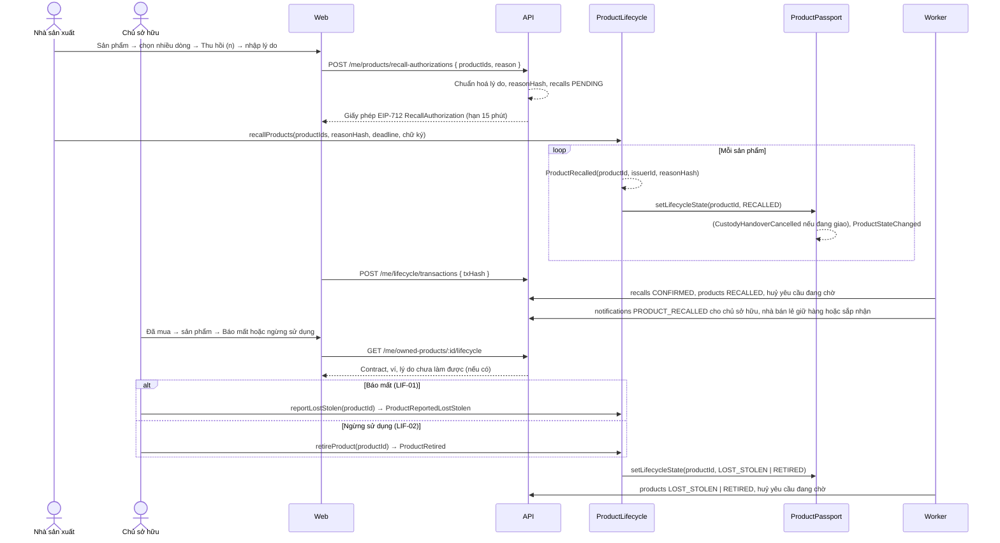

# M10 – Thu hồi, báo mất, ngừng sử dụng và thông báo

M10 có hai phần. Phần đầu đưa sản phẩm vào ba trạng thái cuối:

- Nhà sản xuất **thu hồi** một lô sản phẩm, với một lý do chung cho cả lô.
- Chủ sở hữu **báo mất hoặc bị trộm**.
- Chủ sở hữu **ngừng sử dụng** sản phẩm.

Phần sau là **thông báo trong ứng dụng**, gửi khi sản phẩm bị thu hồi và khi các module trước có việc cần người dùng biết. Người làm thao tác tự ký và trả gas bằng ví MetaMask của mình. Không có ví hệ thống nào gửi giao dịch thay.

| UC     | Tên                                                    | Actor                                                 | Chạm blockchain                                                         |
| ------ | ------------------------------------------------------ | ----------------------------------------------------- | ----------------------------------------------------------------------- |
| RCL-01 | Thu hồi sản phẩm (kèm báo chủ, «include» Notify Owner) | Người đại diện nhà sản xuất                           | `ProductLifecycle.recallProducts` → `ProductPassport.setLifecycleState` |
| LIF-01 | Báo mất hoặc bị trộm                                   | Chủ sở hữu (cá nhân, hoặc người đại diện tổ chức chủ) | `ProductLifecycle.reportLostStolen` → `setLifecycleState`               |
| LIF-02 | Ngừng sử dụng                                          | Chủ sở hữu (cá nhân, hoặc người đại diện tổ chức chủ) | `ProductLifecycle.retireProduct` → `setLifecycleState`                  |
| —      | Xem thông báo, đánh dấu đã đọc                         | Người dùng đăng nhập                                  | Không (Worker tạo thông báo khi chiếu event)                            |

## 1. Quyết định thiết kế

| Mã  | Quyết định                                                                                                                                                                                                                                                                                                                                                                                                                                                                                                                                                                                                                                          | Lý do                                                                                                                                                                                                                                                                 |
| --- | --------------------------------------------------------------------------------------------------------------------------------------------------------------------------------------------------------------------------------------------------------------------------------------------------------------------------------------------------------------------------------------------------------------------------------------------------------------------------------------------------------------------------------------------------------------------------------------------------------------------------------------------------- | --------------------------------------------------------------------------------------------------------------------------------------------------------------------------------------------------------------------------------------------------------------------- |
| D72 | **Contract mới `ProductLifecycle`**, không sửa ProductPassport. Thiết kế ban đầu ghi hàm `ProductPassport.recallProduct`. M10 dùng điểm nối đã chuẩn bị ở D45: ProductLifecycle gọi `ProductPassport.setLifecycleState` qua `LIFECYCLE_CONTRACT_ROLE`. Contract đọc PartyRegistry để biết ví thuộc bên nào và nhà sản xuất có được duyệt không, đọc ProductPassport để lấy bên phát hành, chủ sở hữu và trạng thái, và đọc ServiceTicketManager để biết phiếu sửa đang mở. Deploy script cấp role nên **ví deploy phải là Admin** của PartyRegistry.                                                                                                | Theo lựa chọn của nhóm ("vĩnh viễn, giữ contract"). ProductPassport v2 đang giữ dữ liệu sản phẩm nên không deploy lại (D38, D45).                                                                                                                                     |
| D73 | **Thu hồi theo lô, chung một lý do.** Nhà sản xuất chọn từ 1 đến 50 sản phẩm và nhập lý do (10–1000 ký tự). API làm bốn việc: (1) chuẩn hoá lý do (Unicode NFC, xuống dòng LF, bỏ khoảng trắng đầu cuối); (2) tính `reasonHash = keccak256(JSON {version: 1, reason})`; (3) lưu mỗi sản phẩm một dòng `recalls` ở trạng thái PENDING; (4) ký **giấy phép EIP-712 `RecallAuthorization(issuerId, productIds, reasonHash, deadline)`**, hạn 15 phút. Ví của người đại diện gửi `recallProducts` với đúng các giá trị đó. Chain chỉ lưu hash; nội dung lý do nằm trong CSDL.                                                                           | Theo lựa chọn của nhóm ("chọn nhiều, chung lý do"). Một lô 50 sản phẩm tốn khoảng 2,4 triệu gas (mục 7), vẫn nằm gọn trong một block. Giấy phép buộc lý do đã lưu và hash trên chain là một: nhà sản xuất không đổi được danh sách hay lý do sau khi API đã kiểm tra. |
| D74 | **Thu hồi được ở mọi giai đoạn chưa cuối**: CREATED, IN_DISTRIBUTION, AT_RETAIL, SOLD. Hàng đang giao (IN_DISTRIBUTION) bị huỷ bàn giao trong cùng giao dịch (`CustodyHandoverCancelled`). RECALLED, LOST_STOLEN và RETIRED đều là **trạng thái cuối**. Sản phẩm ở trạng thái cuối không bán, không chuyển nhượng, không gửi bảo hành hay kiểm định được nữa. Yêu cầu chuyển nhượng đã mở trước đó không chấp nhận được, nhưng bên gửi vẫn huỷ được.                                                                                                                                                                                                | Theo lựa chọn của nhóm ("vĩnh viễn"). Một trạng thái hoàn tác được thì dễ bị lạm dụng, ví dụ báo mất để chặn người khác rồi lấy lại để bán.                                                                                                                           |
| D75 | **Chủ sở hữu tự báo mất hay ngừng sử dụng, không cần giấy phép.** Contract tự kiểm tra ba điều: ví là chủ sở hữu hoặc người đại diện của tổ chức chủ đã duyệt (`_actsFor`, như D65); sản phẩm ở trạng thái SOLD; sản phẩm không có phiếu sửa đang mở. Web bắt đánh dấu ô xác nhận "không hoàn tác được" trước khi ký.                                                                                                                                                                                                                                                                                                                               | Không có dữ liệu ngoài chain cần khoá như lý do thu hồi, nên không cần API ký. Khi phiếu sửa đang mở, trung tâm bảo hành đang giữ hàng, nên chặn để phiếu không bị treo.                                                                                              |
| D76 | **Thứ tự event và chiếu lên CSDL.** `ProductRecalled` phát **trước** `ProductStateChanged` trong cùng giao dịch, và Worker chiếu theo thứ tự (block, logIndex) (D71). Nhờ vậy, khi chiếu `ProductRecalled`, CSDL vẫn ghi đúng bên đang giữ hàng và bên sắp nhận hàng. Projector làm các việc sau: (1) chốt `recalls` thành CONFIRMED, kèm `tx_hash` và `recalled_at`, khi hash khớp lý do đã lưu; (2) nếu không khớp, vẫn ghi thu hồi với một lý do mặc định và bật cảnh báo `RECALL_REASON_MISMATCH`; (3) huỷ yêu cầu bảo hành chưa tiếp nhận và yêu cầu kiểm định đang chờ; (4) ghi audit. Báo mất và ngừng sử dụng cũng huỷ hai loại yêu cầu đó. | Chain là nguồn sự thật, CSDL không được lệch âm thầm (D62).                                                                                                                                                                                                           |
| D77 | **Thông báo chỉ trong ứng dụng.** M10 dùng bảng `notifications` có sẵn (kênh IN_APP). Module Notifications có dịch vụ `Notifier` dùng chung cho mọi module. Thông báo được tạo trong cùng DB transaction với lần chiếu event, nên mỗi event chỉ tạo thông báo một lần. Người nhận là một bên (cá nhân hoặc tổ chức), nên mọi người đại diện của một tổ chức thấy chung thông báo của tổ chức. Có 9 loại thông báo: thu hồi; hàng gửi tới nhà bán lẻ (M6); trung tâm tiếp nhận và đóng phiếu sửa (M7); có kết quả kiểm định và bị từ chối kiểm định (M8); có yêu cầu chuyển nhượng gửi tới, bên nhận chấp nhận và bên nhận từ chối (M9).             | Theo lựa chọn của nhóm ("chỉ trong ứng dụng" và bốn nhóm thông báo thêm). Hệ thống không có máy chủ email.                                                                                                                                                            |
| D78 | **Migration `20261110000000_recall_batches`** bỏ ràng buộc UNIQUE trên `recalls.tx_hash` và thay bằng index thường, vì một giao dịch giờ thu hồi nhiều sản phẩm. `recalls.product_id` vẫn UNIQUE: mỗi sản phẩm chỉ thu hồi một lần. Migration không xoá dữ liệu.                                                                                                                                                                                                                                                                                                                                                                                    | Thiết kế CSDL ban đầu giả định mỗi giao dịch thu hồi một sản phẩm.                                                                                                                                                                                                    |
| D79 | **Cảnh báo theo người xem.** Hộ chiếu công khai hiện khung cảnh báo khi sản phẩm ở trạng thái cuối: đỏ khi bị thu hồi, cam khi báo mất, xám khi ngừng sử dụng. Với sản phẩm bị thu hồi, khung có tên nhà sản xuất, lý do và giao dịch. Với báo mất và ngừng sử dụng, khung chỉ có trạng thái và ngày, không có tên chủ. Chủ sở hữu, nhà bán lẻ và nhà sản xuất thấy cùng khung đó, kèm việc cần làm tiếp theo vai của mình.                                                                                                                                                                                                                         | Người mua lại cần biết trước khi trả tiền. Quyền riêng tư của chủ sở hữu giống M6 và M9.                                                                                                                                                                              |

## 2. Luồng



## 3. Bảng traceability

| UC     | Domain Class                  | Database                                                                                                   | Smart Contract                                                    | Event                                                                           |
| ------ | ----------------------------- | ---------------------------------------------------------------------------------------------------------- | ----------------------------------------------------------------- | ------------------------------------------------------------------------------- |
| RCL-01 | Recall, Product, Notification | recalls (PENDING → CONFIRMED, reason_hash, tx_hash), products (RECALLED), notifications (PRODUCT_RECALLED) | `recallProducts(productIds, reasonHash, deadline, authorization)` | ProductRecalled, ProductStateChanged, CustodyHandoverCancelled (hàng đang giao) |
| LIF-01 | Product                       | products (LOST_STOLEN), service_requests và inspection_requests đang chờ (CANCELLED)                       | `reportLostStolen(productId)`                                     | ProductReportedLostStolen, ProductStateChanged                                  |
| LIF-02 | Product                       | products (RETIRED), service_requests và inspection_requests đang chờ (CANCELLED)                           | `retireProduct(productId)`                                        | ProductRetired, ProductStateChanged                                             |
| —      | Notification                  | notifications (IN_APP, SENT, read_at)                                                                      | —                                                                 | Tạo khi chiếu event của M6–M10                                                  |

Điều kiện contract kiểm tra (mỗi điều kiện có ca test):

- Ví gọi `recallProducts` là người đại diện của một nhà sản xuất đã duyệt (`NotAuthorizedManufacturer`).
- Mỗi lô có từ 1 đến 50 sản phẩm (`InvalidBatchSize`), và `reasonHash` khác 0.
- Mọi sản phẩm trong lô do nhà sản xuất đó phát hành (`NotIssuer`) và chưa ở trạng thái cuối (`ProductNotRecallable`).
- Giấy phép do registrar ký, khớp nhà sản xuất, danh sách sản phẩm và hash lý do, và chưa quá `deadline` (`InvalidAuthorization`, `AuthorizationExpired`).
- Báo mất và ngừng sử dụng: sản phẩm đang SOLD (`ProductNotSold`), ví là chủ hoặc người đại diện tổ chức chủ (`NotProductOwner`), không có phiếu sửa đang mở (`ProductUnderRepair`).
- ProductPassport chỉ nhận `setLifecycleState` từ địa chỉ có `LIFECYCLE_CONTRACT_ROLE`, và chỉ cho các bước chuyển trạng thái hợp lệ (`InvalidStateTransition`).

State machine sản phẩm (bảng `PRODUCT_STATE_TRANSITIONS` trong `packages/shared/src/domain/state-machines.ts`):

```text
CREATED ─────────┐
IN_DISTRIBUTION ─┤
AT_RETAIL ───────┼──recallProducts──▶ RECALLED
SOLD ────────────┘
SOLD ──reportLostStolen──▶ LOST_STOLEN
SOLD ──retireProduct─────▶ RETIRED
(RECALLED, LOST_STOLEN, RETIRED là trạng thái cuối)
```

## 4. Màn hình

- **Sản phẩm** (nhà sản xuất):
  - Chọn nhiều dòng thì có nút **Thu hồi (n)**. Nút chỉ đếm sản phẩm đã lên blockchain và chưa ở trạng thái cuối.
  - Khung thu hồi liệt kê số serial các sản phẩm đã chọn. Chọn quá 50 thì khung báo phải bỏ bớt. Nhập lý do, đánh dấu **Tôi hiểu thu hồi không hoàn tác được**, rồi bấm **Ký và thu hồi n sản phẩm**. Khung hiện ba bước: hệ thống cấp giấy phép, ví gửi giao dịch, chờ block finalized.
  - Bộ lọc mới **Đã thu hồi**.
  - Trang chi tiết sản phẩm bị thu hồi hiện khung đỏ có lý do.
- **Đã mua → chi tiết** (chủ sở hữu):
  - Khung **Báo mất hoặc ngừng sử dụng** có hai thao tác, **Báo mất hoặc bị trộm** và **Ngừng sử dụng**. Mỗi thao tác phải đánh dấu **Tôi hiểu thao tác này không hoàn tác được** trước khi ký.
  - Khi chưa làm được, khung ghi lý do: chưa liên kết ví, đang có phiếu sửa, doanh nghiệp bị khoá…
  - Khi sản phẩm đã ở trạng thái cuối, khung cảnh báo thay cho các thao tác. Khung bảo hành ghi "Bảo hành không còn áp dụng".
- **Kho hàng** (nhà bán lẻ): hàng bị thu hồi vẫn nằm ở tab Đang bán, kèm nhãn **Bị thu hồi** thay cho nút **Bán**. Trang chi tiết có khung đỏ "Gỡ sản phẩm khỏi kệ".
- **Chuyển nhượng**:
  - Yêu cầu của sản phẩm đã ở trạng thái cuối có ghi chú riêng.
  - Bên nhận không còn nút **Chấp nhận** hay **Từ chối**. Bên gửi chỉ còn nút **Huỷ yêu cầu**.
- **Hộ chiếu công khai** (`/p/<mã>`):
  - Khung cảnh báo nằm trên cùng (đỏ khi bị thu hồi, cam khi báo mất, xám khi ngừng sử dụng).
  - Lịch sử có tab **Thu hồi, báo mất**.
  - Nhật ký on-chain có 3 nhãn event mới.
- **Thông báo** (`/notifications`):
  - Chuông trên thanh đầu trang hiện số thông báo chưa đọc.
  - Trang liệt kê thông báo mới nhất trước. Thông báo thu hồi có tiêu đề màu đỏ.
  - Bấm một thông báo thì nó được đánh dấu đã đọc và trang liên quan mở ra. Có nút **Đánh dấu tất cả đã đọc**.

## 5. API

| Phương thức | Đường dẫn                            | Quyền                                       | Mô tả                                                                                                 |
| ----------- | ------------------------------------ | ------------------------------------------- | ----------------------------------------------------------------------------------------------------- |
| POST        | `/me/products/recall-authorizations` | Người đại diện nhà sản xuất đã duyệt, có ví | `{ productIds (1–50), reason (10–1000 ký tự) }` → giấy phép `RecallAuthorization` (hạn 15 phút) (201) |
| GET         | `/me/owned-products/:id/lifecycle`   | Chủ sở hữu hiện tại (hoặc người đại diện)   | Trạng thái cuối nếu có, lý do chưa thao tác được, contract, ví, `chainProductId`                      |
| POST        | `/me/lifecycle/transactions`         | Đăng nhập, có ví                            | Báo txHash của 3 hàm ProductLifecycle (202); API theo dõi tới khi finalized                           |
| GET         | `/public/products/:code/lifecycle`   | Công khai                                   | Cảnh báo trạng thái cuối: trạng thái, ngày, txHash, lý do và tên nhà sản xuất (khi thu hồi)           |
| GET         | `/me/notifications`                  | Đăng nhập                                   | Thông báo của người dùng và tổ chức họ đại diện, mới nhất trước, kèm số chưa đọc                      |
| GET         | `/me/notifications/summary`          | Đăng nhập                                   | Số thông báo chưa đọc (cho chuông trên thanh đầu trang)                                               |
| POST        | `/me/notifications/read`             | Đăng nhập                                   | `{ ids? }` đánh dấu đã đọc các thông báo đã chọn, hoặc tất cả nếu không gửi `ids` (200)               |

## 6. Cài đặt khi cập nhật từ M9

M10 có **một migration nhỏ** (D78). Migration không xoá dữ liệu: tài khoản, doanh nghiệp, sản phẩm, bảo hành, phiếu sửa chữa, kết quả kiểm định và yêu cầu chuyển nhượng giữ nguyên.

1. Tắt `pnpm dev`. Giải nén đè lên thư mục dự án rồi chạy `pnpm install` (lệnh này build lại `@dpp/shared`).
2. `pnpm db:up`, rồi `pnpm db:deploy` để chạy migration `20261110000000_recall_batches`. Chạy thêm `pnpm --filter @dpp/api db:deploy:test` cho CSDL test.
3. `pnpm --filter @dpp/contracts deploy:lifecycle:monad` (nhập mật khẩu keystore). Script làm các việc sau:
   - đọc `PARTY_REGISTRY_ADDRESS`, `PRODUCT_PASSPORT_ADDRESS` và `SERVICE_TICKET_MANAGER_ADDRESS` trong `.env`, và kiểm tra cả ba có contract trên chain;
   - kiểm tra ví deploy là Admin của PartyRegistry;
   - deploy vào thư mục Ignition `chain-10143-lifecycle-v1` và cấp `LIFECYCLE_CONTRACT_ROLE`;
   - in hai dòng `PRODUCT_LIFECYCLE_ADDRESS` và `PRODUCT_LIFECYCLE_DEPLOY_BLOCK` để chép vào `.env`.
4. `pnpm dev`. Worker bắt đầu quét ProductLifecycle từ block deploy.

Chạy cục bộ: sau `deploy:transfers:local`, chạy `deploy:lifecycle:local` rồi chép hai dòng in ra.

## 7. Gas

Đo trên Hardhat (Monad định giá opcode khác; số liệu chính thức ở M13). Web đặt gas limit bằng ước lượng cộng 10%.

| Hàm                            | Gas đã dùng |
| ------------------------------ | ----------- |
| `recallProducts` (1 sản phẩm)  | 96.089      |
| `recallProducts` (10 sản phẩm) | 522.879     |
| `recallProducts` (50 sản phẩm) | 2.420.646   |
| `reportLostStolen`             | 61.699      |
| `retireProduct`                | 61.783      |

Thu hồi tăng gần tuyến tính, khoảng 47.000 gas cho mỗi sản phẩm thêm vào lô. Phần cố định (kiểm tra chữ ký EIP-712 và quyền nhà sản xuất) chỉ trả một lần, nên thu hồi theo lô rẻ hơn thu hồi từng sản phẩm. Phần còn lại cho mỗi sản phẩm gồm đọc ProductPassport, đổi trạng thái và phát hai event. Báo mất và ngừng sử dụng rẻ vì không có chữ ký cần kiểm tra.

## 8. Test chứng minh

| Test                                                                   | Chứng minh                                                                                                                                                                                                                                                                                                                                                                                                                                                                                                                                                                         |
| ---------------------------------------------------------------------- | ---------------------------------------------------------------------------------------------------------------------------------------------------------------------------------------------------------------------------------------------------------------------------------------------------------------------------------------------------------------------------------------------------------------------------------------------------------------------------------------------------------------------------------------------------------------------------------- |
| `packages/contracts/test/lifecycle/product-lifecycle.test.ts`          | 10 ca: (1) thu hồi một lô ở mọi giai đoạn, hàng đang giao tự huỷ bàn giao; (2) `ProductRecalled` phát trước `ProductStateChanged`; (3) chỉ nhà sản xuất phát hành thu hồi được; (4) lô 1–50 sản phẩm, giấy phép khoá nhà sản xuất, danh sách và lý do; (5) thu hồi là trạng thái cuối; (6) chủ báo mất hoặc ngừng sử dụng, sau đó nhà sản xuất không thu hồi được nữa; (7) chỉ chủ sở hữu, chỉ khi SOLD và không có phiếu sửa mở; (8) người đại diện của tổ chức chủ báo mất được; (9) thiếu `LIFECYCLE_CONTRACT_ROLE` thì ProductPassport từ chối; (10) digest khớp `@dpp/shared` |
| `packages/shared/src/domain/recall-reason.spec.ts`                     | Chuẩn hoá lý do trước khi băm; đổi một ký tự thì hash đổi                                                                                                                                                                                                                                                                                                                                                                                                                                                                                                                          |
| `apps/api/src/modules/lifecycle/application/lifecycle.spec.ts`         | Chuẩn bị thu hồi lưu lý do cho cả lô và ký đúng giấy phép; projector chốt lý do, báo đúng các bên, huỷ yêu cầu đang chờ; hash không khớp thì vẫn ghi và bật cảnh báo; sản phẩm lạ thì chỉ cảnh báo                                                                                                                                                                                                                                                                                                                                                                                 |
| `apps/api/src/modules/notifications/application/notifications.spec.ts` | Bỏ người nhận trùng; danh sách gồm thông báo của cá nhân và tổ chức đại diện; đánh dấu đã đọc không đụng thông báo của người khác                                                                                                                                                                                                                                                                                                                                                                                                                                                  |
| `apps/api/test/lifecycle/lifecycle.e2e-spec.ts`                        | 6 ca trọn luồng trên Hardhat node: (1) thông báo hàng gửi tới và yêu cầu chuyển nhượng; (2) thu hồi một lô ở cửa hàng, đã bán và đang giao, báo các bên, huỷ yêu cầu đang chờ; (3) yêu cầu chuyển nhượng của sản phẩm đã thu hồi không chấp nhận được, bên gửi vẫn huỷ được; (4) báo mất là trạng thái cuối; (5) phiếu sửa mở thì chưa báo mất được, rồi ngừng sử dụng; (6) đọc và đánh dấu thông báo, không có cảnh báo bất thường                                                                                                                                                |
| `apps/web/src/features/lifecycle/lifecycle.spec.ts`                    | Web chỉ cho thu hồi trạng thái chưa cuối; schema nhận cảnh báo công khai và khung của chủ; thông báo dẫn tới đúng trang theo loại và người nhận                                                                                                                                                                                                                                                                                                                                                                                                                                    |

## 9. Giới hạn

- Thu hồi, báo mất và ngừng sử dụng không hoàn tác được (D74). Báo nhầm thì không sửa được trên hệ thống; nhóm chấp nhận điều này để trạng thái cuối luôn đáng tin.
- Lý do thu hồi chỉ lưu trong CSDL; chain giữ hash. Nếu CSDL mất dữ liệu, hash vẫn chứng minh được lý do gốc khi có bản sao nội dung.
- Thông báo không gửi email hay đẩy về điện thoại. Người dùng xem ở chuông và trang **Thông báo**.
- Thông báo của tổ chức có chung một trạng thái đã đọc: một người đại diện đọc thì những người khác cũng thấy là đã đọc.
- Phiếu sửa đã mở trước khi thu hồi vẫn để trung tâm bảo hành đóng như bình thường. Sau khi đóng, sản phẩm không gửi bảo hành được nữa.
- Mỗi lần thu hồi tối đa 50 sản phẩm. Lô lớn hơn phải chia thành nhiều giao dịch.
