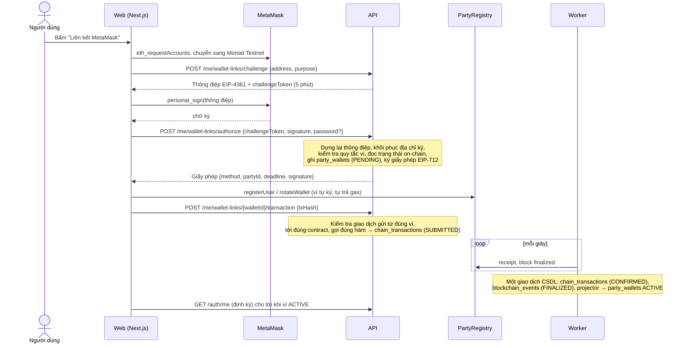

# M2 – Identity & Auth

Module M2 hiện thực bốn Use Case tài khoản theo mô hình **Hybrid (Web2 + Web3)**:

| UC     | Tên                      | Kiểu | Chạm blockchain                                |
| ------ | ------------------------ | ---- | ---------------------------------------------- |
| ACC-01 | Đăng ký tài khoản        | Web2 | Không                                          |
| ACC-02 | Đăng nhập / Đăng xuất    | Web2 | Không                                          |
| ACC-03 | Liên kết ví MetaMask     | Web3 | Ví người dùng gọi `PartyRegistry.registerUser` |
| ACC-04 | Xoay ví cá nhân (đổi ví) | Web3 | Ví mới gọi `PartyRegistry.rotateWallet`        |

## 1. Quyết định thiết kế bổ sung

Các quyết định dưới đây bổ sung cho bảng D1–D13 của tài liệu thiết kế (M0).

| Mã  | Quyết định                                                                                                                                                                                           | Lý do                                                                                                                                                                                          |
| --- | ---------------------------------------------------------------------------------------------------------------------------------------------------------------------------------------------------- | ---------------------------------------------------------------------------------------------------------------------------------------------------------------------------------------------- |
| D14 | **Hybrid**: đăng ký chỉ tạo `users` + `parties` (off-chain). Party chỉ được đăng ký on-chain khi người dùng liên kết MetaMask; **ví người dùng tự ký và tự trả gas**, hệ thống không có ví gửi thay. | Theo yêu cầu của nhóm. Người dùng chỉ cần MON khi thật sự giao dịch.                                                                                                                           |
| D15 | Backend **cấp giấy phép EIP-712** (`WalletBinding`) bằng khoá có `REGISTRAR_ROLE`; contract chỉ nhận `registerUser`/`rotateWallet` kèm giấy phép hợp lệ, và ví được gắn luôn là `msg.sender`.        | Nếu không có giấy phép, bất kỳ ai cũng tự gọi contract để chiếm một `partyId` của người khác. Khoá registrar chỉ ký, không gửi giao dịch, không cần MON; admin thu hồi được bằng `revokeRole`. |
| D16 | Đăng xuất bằng cột **`users.session_version`**: JWT mang giá trị tại lúc cấp; đăng xuất hoặc khoá tài khoản tăng giá trị này nên mọi token cũ hết hiệu lực ngay (mọi thiết bị).                      | Không thêm bảng, vẫn giữ 22 bảng của thiết kế.                                                                                                                                                 |
| D17 | **Mỗi địa chỉ ví chỉ được gắn một lần** trong toàn hệ thống, kể cả sau khi đã bị xoay đi.                                                                                                            | Khớp `UNIQUE(address)` của `party_wallets` với `_usedWallets` trên contract, CSDL và chain không thể lệch nhau.                                                                                |
| D18 | Đổi ví (ACC-04) chỉ cần **ví mới** ký; quyền đổi đến từ việc nhập lại mật khẩu.                                                                                                                      | Ví cũ có thể đã mất, đó chính là lý do phải đổi ví.                                                                                                                                            |

**Cần nhóm quyết định:** bảng `custodial_keys` không còn được dùng vì mô hình Hybrid không tạo ví custodial. M2 giữ nguyên bảng (không đổi schema). Nếu nhóm đồng ý bỏ, M3 sẽ thêm migration xoá bảng và cập nhật tài liệu thành 21 bảng.

## 2. Luồng liên kết ví (ACC-03, ACC-04)

## 3. API

Tiền tố `/api/v1`. Trình duyệt gọi qua chính web (Next.js chuyển tiếp), nên cookie phiên là cookie first-party.

| Phương thức | Đường dẫn                                 | UC        | Phiên    | Kết quả                                               |
| ----------- | ----------------------------------------- | --------- | -------- | ----------------------------------------------------- |
| POST        | `/auth/register`                          | ACC-01    | Không    | 201 `IdentitySnapshot` + cookie `dpp_session`         |
| POST        | `/auth/login`                             | ACC-02    | Không    | 200 `IdentitySnapshot` + cookie                       |
| POST        | `/auth/logout`                            | ACC-02    | Tuỳ chọn | 204, xoá cookie, thu hồi mọi phiên                    |
| GET         | `/auth/me`                                | —         | Có       | 200 `IdentitySnapshot` (tài khoản, Party, lịch sử ví) |
| POST        | `/me/wallet-links/challenge`              | ACC-03/04 | Có       | 201 `WalletLinkChallenge`                             |
| POST        | `/me/wallet-links/authorize`              | ACC-03/04 | Có       | 201 `WalletLinkAuthorization`                         |
| POST        | `/me/wallet-links/{walletId}/transaction` | ACC-03/04 | Có       | 202 `WalletSummary`                                   |

Kiểu dữ liệu nằm ở `packages/shared/src/api/identity.ts`. Lỗi nghiệp vụ có trường `code` ổn định, ví dụ `EMAIL_TAKEN`, `INVALID_CREDENTIALS`, `WALLET_ALREADY_USED`, `PASSWORD_CONFIRMATION_FAILED`, `TX_MISMATCH`.

## 4. Traceability

| UC                    | Domain Class       | Database                                                                                                    | Smart Contract                                                                 | Event                                               | Ràng buộc chính                                                                                                       | Test                                                                                                    |
| --------------------- | ------------------ | ----------------------------------------------------------------------------------------------------------- | ------------------------------------------------------------------------------ | --------------------------------------------------- | --------------------------------------------------------------------------------------------------------------------- | ------------------------------------------------------------------------------------------------------- |
| ACC-01 Register       | User, Party        | `users`, `parties` (USER)                                                                                   | — (off-chain)                                                                  | —                                                   | email UNIQUE + chữ thường; `password_hash` Argon2id; `ck_parties_subject`                                             | `account-access.spec.ts`, `auth.e2e-spec.ts`                                                            |
| ACC-02 Login / Logout | User               | `users.session_version`, `audit_logs`                                                                       | —                                                                              | —                                                   | `ck_users_session_version_non_negative`; tài khoản LOCKED không đăng nhập được                                        | `account-access.spec.ts`, `identity-adapters.spec.ts`, `auth.e2e-spec.ts`                               |
| ACC-03 Link MetaMask  | Party, PartyWallet | `party_wallets` (PENDING → ACTIVE), `parties.chain_party_id` [P], `chain_transactions`, `blockchain_events` | `PartyRegistry.registerUser(partyId, deadline, authorization)`                 | `PartyRegistered(partyId, kind, wallet)`            | EIP-4361 khớp từng ký tự; giấy phép EIP-712 của `REGISTRAR_ROLE`; `ux_wallet_one_pending_personal`; ví chưa từng dùng | `party-registry.test.ts`, `wallet-link.spec.ts`, `wallet-projection.spec.ts`, `wallet-link.e2e-spec.ts` |
| ACC-04 Rotate Wallet  | PartyWallet        | `party_wallets` (cũ ROTATED + `revoked_at`, mới ACTIVE)                                                     | `PartyRegistry.rotateWallet(partyId, previousWallet, deadline, authorization)` | `WalletRotated(partyId, previousWallet, newWallet)` | nhập lại mật khẩu; `previousWallet` phải là ví hiện tại on-chain; `ux_wallet_one_active_personal`                     | như ACC-03                                                                                              |

`partyId` (bytes32) suy ra hai chiều từ UUID của dòng `parties` (`packages/shared/src/domain/party-id.ts`), nên Indexer tìm đúng Party từ event mà không cần tra thêm.

## 5. Bảo mật

- **Mật khẩu**: Argon2id, bộ nhớ 19 MiB, 2 vòng lặp, 1 luồng (khuyến nghị OWASP), salt ngẫu nhiên mỗi lần băm. Sai email hay sai mật khẩu đều trả cùng thông báo; email không tồn tại vẫn chạy một lần Argon2id giả để thời gian phản hồi giống nhau.
- **Phiên**: JWT HS256 (`JWT_SECRET` ≥ 32 ký tự) trong cookie `httpOnly`, `SameSite=Lax`, `Secure` khi web chạy HTTPS. Mỗi request đối chiếu `session_version` và trạng thái tài khoản trong CSDL.
- **CSRF**: request ghi dữ liệu mang header `Origin` khác `WEB_ORIGIN` bị chặn (403 `ORIGIN_NOT_ALLOWED`).
- **Dò mật khẩu**: tối đa `AUTH_RATE_LIMIT_PER_MINUTE` (mặc định 10) lần đăng ký/đăng nhập mỗi phút cho một IP.
- **EIP-4361**: thông điệp ràng buộc domain, URI, chain ID, nonce ngẫu nhiên, hết hạn sau 5 phút; challenge token ràng buộc đúng người dùng và đúng ví. API dựng lại thông điệp và so khớp từng ký tự trước khi khôi phục địa chỉ ký.
- **EIP-712**: domain gồm chain ID và địa chỉ contract nên giấy phép không dùng lại được ở mạng hay contract khác; hạn dùng 15 phút; giấy phép cho `registerUser` không dùng được cho `rotateWallet`.
- **Nhật ký**: `audit_logs` (chỉ INSERT) ghi đăng ký, đăng nhập thành công/thất bại, đăng xuất, cấp giấy phép, gửi giao dịch, kích hoạt và xoay ví.

## 6. Cấu hình

| Biến                           | Bắt buộc      | Ý nghĩa                                                        |
| ------------------------------ | ------------- | -------------------------------------------------------------- |
| `JWT_SECRET`                   | Có            | Khoá ký JWT. Tạo: `pnpm --filter @dpp/api secret:new`          |
| `SESSION_TTL_MINUTES`          | Không (720)   | Thời gian sống của phiên                                       |
| `AUTH_RATE_LIMIT_PER_MINUTE`   | Không (10)    | Giới hạn thử đăng nhập/đăng ký                                 |
| `REGISTRAR_SIGNER_PRIVATE_KEY` | Cho ACC-03/04 | Khoá ký giấy phép. Tạo: `pnpm --filter @dpp/api registrar:new` |
| `PARTY_REGISTRY_ADDRESS`       | Cho ACC-03/04 | In ra sau `pnpm --filter @dpp/contracts deploy:monad`          |
| `NEXT_PUBLIC_CHAIN_ID`         | Có            | Phải trùng `CHAIN_ID`, MetaMask được chuyển sang mạng này      |

Thiếu hai biến của ACC-03/04 thì API vẫn chạy, trang Tài khoản báo "chưa cấu hình PartyRegistry".

## 7. Gas

Đo trên Hardhat node khi chạy thử giao diện (để tham khảo; Monad định giá opcode khác, số liệu chính thức đo trên testnet ở M13):

| Hàm            | Gas limit đặt | Gas đã dùng |
| -------------- | ------------- | ----------- |
| `registerUser` | 109.520       | 99.564      |
| `rotateWallet` | 96.886        | 83.204      |

Monad tính phí theo **gas limit**, nên giao diện đặt gas limit bằng ước lượng cộng 10% thay vì mức dư mặc định của MetaMask. Mọi giao dịch được lưu ở `chain_transactions` (nonce, gas limit, phí, gas đã dùng) làm nguồn số liệu benchmark.

## 8. Giới hạn để lại cho M3

- Worker chỉ chốt các giao dịch mà web đã báo `txHash`. Nếu người dùng đóng trang ngay sau khi MetaMask gửi, ví vẫn được gắn on-chain; Indexer quét log của M3 sẽ chiếu event đó. Yêu cầu PENDING trong trường hợp này không bị job dọn dẹp xoá, vì job kiểm tra `isWalletUsed` trên chain trước.
- Chưa hỗ trợ ví hợp đồng thông minh (EIP-1271), chỉ ví EOA như MetaMask.
