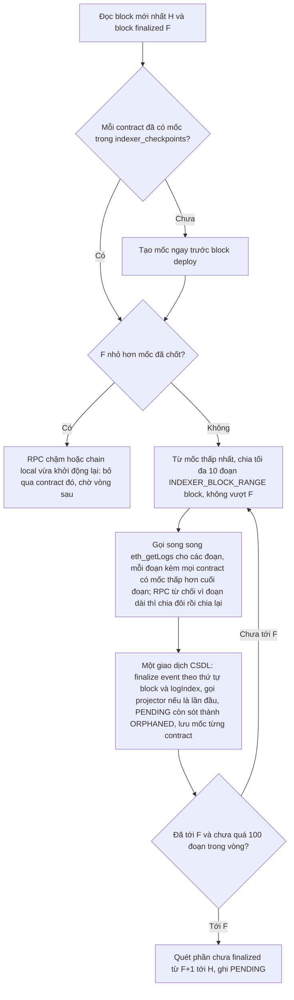

# M3 – Indexer & đối soát

M3 bổ sung phần đồng bộ blockchain chạy trong Worker. Sau M3, dữ liệu chiếu trong CSDL không còn phụ thuộc vào việc web có báo `txHash` hay không.

| Hạng mục           | Nội dung                                                                                                           |
| ------------------ | ------------------------------------------------------------------------------------------------------------------ |
| Indexer            | Quét log các contract từ block deploy, ghi `blockchain_events` PENDING → FINALIZED/ORPHANED, lưu mốc từng contract |
| Chiếu đúng một lần | Indexer và luồng chốt giao dịch (M2) dùng chung một hàm chốt event, mỗi event chỉ gọi projector một lần            |
| Đối soát           | Định kỳ so ví trong CSDL với `PartyRegistry.walletOf`, lệch thì tạo `anomaly_alerts` mức HIGH                      |
| Trạng thái         | `/health/ready` có thêm thành phần `indexer` (độ trễ so với chain)                                                 |
| CSDL               | Bỏ bảng `custodial_keys`, còn **21 bảng**                                                                          |
| Giao diện          | Bỏ trang Bộ giao diện, footer, hai mục giới thiệu; lịch sử hồ sơ mẫu chia tab                                      |

## 1. Quyết định thiết kế

| Mã  | Quyết định                                                                                                                                                                                                                                            | Lý do                                                                                                                                                                                                                                                                          |
| --- | ----------------------------------------------------------------------------------------------------------------------------------------------------------------------------------------------------------------------------------------------------- | ------------------------------------------------------------------------------------------------------------------------------------------------------------------------------------------------------------------------------------------------------------------------------ |
| D19 | Bỏ bảng `custodial_keys` (migration `20261028120000_drop_custodial_keys`).                                                                                                                                                                            | Mô hình Hybrid (D14) không tạo ví custodial; ví người dùng luôn là `NON_CUSTODIAL`.                                                                                                                                                                                            |
| D20 | Indexer quét hai lượt: phần chưa finalized ghi **PENDING** để biết sớm; khi đoạn block đã finalized thì **quét lại đoạn đó làm chuẩn**. Event có trong kết quả thành FINALIZED và được chiếu; event PENDING còn sót trong đoạn đó thành **ORPHANED**. | Kết quả `eth_getLogs` của block finalized không bao giờ đổi, nên không cần so từng hash block cha. Log xuất hiện sau reorg vẫn được bắt ở lượt chuẩn.                                                                                                                          |
| D21 | Chốt event bằng một hàm chung `EventStore.finalize()`: `UPDATE … WHERE finality_status <> 'FINALIZED'`, chưa có dòng thì `INSERT … ON CONFLICT DO NOTHING`. Projector và mốc quét chạy trong **cùng giao dịch CSDL**.                                 | Indexer và luồng chốt giao dịch có thể cùng thấy một event; câu UPDATE khoá dòng nên chỉ một bên nhận được "lần đầu" và gọi projector.                                                                                                                                         |
| D22 | Đối soát đọc `walletOf` **tại block Indexer đã chốt**, bỏ qua Party có event sau mốc đó (đang đổi ví). Cảnh báo OPEN cùng luật, cùng Party thì không tạo thêm.                                                                                        | So đúng hai trạng thái ở cùng một thời điểm, không báo nhầm khi người dùng vừa đổi ví; không ngập cảnh báo khi lệch kéo dài.                                                                                                                                                   |
| D23 | Indexer chậm hoặc chưa chạy chỉ làm `/health/ready` ở mức `degraded` (vẫn HTTP 200).                                                                                                                                                                  | Dữ liệu vẫn đúng, chỉ cập nhật trễ; API vẫn phục vụ được.                                                                                                                                                                                                                      |
| D24 | Web báo `txHash` sau khi Indexer đã kích hoạt ví bằng chính giao dịch đó: API vẫn nhận (202) và chỉ ghi `chain_transactions`.                                                                                                                         | Trên Monad block finalized sau khoảng 1 giây, Indexer có thể chiếu trước khi web kịp báo; người dùng không được thấy lỗi khi việc liên kết thực tế đã xong.                                                                                                                    |
| D71 | (Bổ sung sau M9) Mỗi lần gọi `eth_getLogs` lấy log của **mọi contract** còn cần đoạn đó (mảng địa chỉ). Khi đang bắt kịp, Worker gọi **song song 10 đoạn** rồi chốt một lần; event chiếu theo thứ tự (block, logIndex) trên chain.                    | Quét lần lượt từng contract chỉ được khoảng 20 block/giây; máy tắt một tuần (khoảng 2 triệu block) phải chờ hơn một ngày. Gộp và gọi song song nhanh hơn vài chục lần (thử với RPC giả trễ 0,4 giây/lần: khoảng 2.500 block/giây), vẫn dưới 50 request/giây của RPC công khai. |

## 2. Một vòng quét của Indexer

- Contract đã quét xa hơn (ví dụ contract vừa deploy) chỉ được ghép vào lời gọi từ đoạn vượt mốc của nó, nên log cũ không bị đọc lại.
- Mỗi lượt 10 đoạn song song (1.000 block với đoạn 100 block), mỗi vòng tối đa 100 đoạn (10.000 block). Lúc bắt kịp, Worker gọi khoảng 20–25 request/giây, dưới giới hạn 50 request/giây của RPC công khai Monad Testnet.
- Lỗi ở một lượt (RPC lỗi, projector ném lỗi) làm cả giao dịch CSDL của lượt đó huỷ; mốc không tiến, vòng sau quét lại. Không có event nào bị bỏ qua. Lỗi tạm của RPC (ví dụ `error getting block header from triedb and archive` khi đọc block cũ) chỉ ghi một dòng cảnh báo.
- Chậm hơn 1.000 block thì log Worker báo tiến độ 30 giây một lần: "Indexer đang bắt kịp chain: còn … block, khoảng … phút nữa".
- Event của contract nhưng không có projector (ví dụ `RoleGranted` khi deploy) vẫn được lưu ở `blockchain_events` để tra cứu.

## 3. Cấu hình

| Biến                          | Mặc định | Ý nghĩa                                                                                                                            |
| ----------------------------- | -------- | ---------------------------------------------------------------------------------------------------------------------------------- |
| `PARTY_REGISTRY_DEPLOY_BLOCK` | (trống)  | Block bắt đầu quét. Để trống thì chỉ quét từ block finalized lúc Worker chạy lần đầu                                               |
| `INDEXER_POLL_INTERVAL_MS`    | 1000     | Chu kỳ quét                                                                                                                        |
| `INDEXER_BLOCK_RANGE`         | 100      | Số block mỗi lần `eth_getLogs`. RPC công khai của Monad giới hạn 100 block mỗi lần (vượt thì trả lỗi -32602 "Invalid block range") |
| `RECONCILE_INTERVAL_MINUTES`  | 10       | Chu kỳ đối soát ví                                                                                                                 |

Deploy mới thì script in sẵn `PARTY_REGISTRY_DEPLOY_BLOCK`. Với PartyRegistry đã deploy trên Monad Testnet ở M2, block deploy lấy từ `packages/contracts/ignition/deployments/chain-10143/journal.jsonl` (bản ghi `TRANSACTION_CONFIRM`, trường `blockNumber`).

Monad sinh block khoảng 0,3 giây một block (gần 290.000 block mỗi ngày). Lần chạy đầu, hoặc sau khi tắt máy nhiều ngày, Indexer phải quét bù cả khoảng đó; trang Trạng thái hệ thống báo "Indexer chậm … block" cho tới khi bắt kịp. Với RPC công khai (đoạn 100 block), Worker quét khoảng 1.500–2.000 block mỗi giây, tức khoảng 3 phút cho mỗi ngày tắt máy. Có thể đổi `RPC_URL` sang RPC cho phép đoạn dài hơn rồi tăng `INDEXER_BLOCK_RANGE` để bắt kịp nhanh hơn nữa.

## 4. Đối soát ví

Worker chạy `ReconcilePartyWallets` theo chu kỳ:

1. Lấy block Indexer đã chốt cho PartyRegistry (mọi event tới block này đã được chiếu).
2. Đọc từng trang 100 Party người dùng có `chain_party_id` kèm ví PERSONAL đang ACTIVE.
3. Sau đó mới lấy danh sách Party có event sau mốc, rồi bỏ qua các Party này ở lượt hiện tại.
4. Gọi `walletOf(partyId)` tại đúng block ở bước 1; khác ví trong CSDL thì tạo cảnh báo `PARTY_WALLET_MISMATCH` (HIGH) kèm ví on-chain, ví trong CSDL và block đã so.

Thứ tự bước 2 rồi 3 là có chủ đích: mọi thay đổi đã chiếu vào CSDL sau mốc đều có event tương ứng, nên chắc chắn nằm trong danh sách bỏ qua. Màn hình xem và xử lý cảnh báo thuộc M12.

Nút RPC của Monad chỉ giữ trạng thái của các block gần đây (khoảng vài chục nghìn block, tuỳ ổ đĩa của nhà cung cấp), nên `eth_call` tại block cũ có thể bị từ chối. Trong lúc Indexer đang bắt kịp từ block deploy, log Worker có thể báo "Chưa đối soát được ví"; khi Indexer bắt kịp, lượt đối soát kế tiếp chạy bình thường.

## 5. Giao diện

- Header chỉ còn logo, tên mạng và tài khoản. Trang `/system/status` vẫn mở được bằng đường dẫn và có thêm mục Indexer; liên kết sẽ đặt trong khu Quản trị ở M4.
- Trang chủ: nút theo phiên đăng nhập (Tạo tài khoản và Đăng nhập; đã đăng nhập thì Liên kết ví MetaMask hoặc Xem tài khoản).
- Lịch sử hồ sơ mẫu chia tab: Tất cả, Phân phối, Bảo hành (gồm sửa chữa), Chuyển nhượng. Tab theo mẫu WAI-ARIA: phím mũi tên, Home, End; tự xuống dòng trên điện thoại.

## 6. Test chứng minh

| Test                                                                            | Chứng minh                                                                                                                                                                                                                |
| ------------------------------------------------------------------------------- | ------------------------------------------------------------------------------------------------------------------------------------------------------------------------------------------------------------------------- |
| `apps/api/src/modules/chain-sync/application/index-chain-events.spec.ts`        | Quét từ block deploy, PENDING → FINALIZED, reorg → ORPHANED rồi chốt lại, chia đôi đoạn, chiếu một lần; gộp nhiều contract một lần gọi, chiếu đúng thứ tự trên chain, gọi song song khi bắt kịp, RPC lỗi tạm thì quét lại |
| `apps/api/src/modules/chain-sync/domain/indexer-checkpoint.spec.ts`             | Đoạn quét kế tiếp, mốc đã quan sát không thấp hơn mốc đã chốt                                                                                                                                                             |
| `apps/api/src/modules/identity/application/party-wallet-reconciliation.spec.ts` | Đối soát đúng block, cảnh báo một lần, bỏ qua Party đang đổi ví                                                                                                                                                           |
| `apps/api/test/chain-sync/indexer.e2e-spec.ts`                                  | Trên Hardhat node: web không báo `txHash` vẫn kích hoạt ví; báo sau không chiếu lại; đối soát tạo cảnh báo khi CSDL bị sửa                                                                                                |
| `apps/api/test/health.e2e-spec.ts`                                              | Thành phần `indexer`: up khi bắt kịp, degraded khi chưa chạy hoặc chậm                                                                                                                                                    |
| `apps/web/src/features/passport-specimen/history-tabs.spec.ts`                  | Mỗi sự kiện thuộc đúng một tab, không sót sự kiện                                                                                                                                                                         |

## 7. Ghi chú vận hành

- Khởi động lại Hardhat node làm chain local mất dữ liệu cũ, trong khi CSDL vẫn giữ mốc quét và bản chiếu của chain cũ. Worker sẽ cảnh báo "RPC báo block finalized thấp hơn mốc đã quét"; chạy `pnpm --filter @dpp/api db:reset` rồi deploy lại contract.
- RPC công khai chạy sau bộ cân bằng tải, hai lần gọi liên tiếp có thể tới hai nút khác nhau. Indexer kiểm tra hash block của từng log và đợi vòng sau khi lệch; trường hợp hiếm còn lại được job đối soát phát hiện.
- Kết nối CSDL đặt múi giờ phiên là UTC. PostgreSQL cài trực tiếp trên Windows thường dùng giờ máy (UTC+7); khi đó adapter `pg` của Prisma ghi lệch 7 giờ vào cột `timestamptz` nếu không ép UTC.
