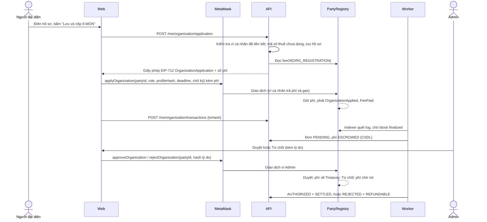

# M4 – Doanh nghiệp và phí MON

M4 hiện thực các Use Case về tổ chức (doanh nghiệp) theo mô hình Hybrid đã chốt ở M2: tài khoản là Web2, mọi giao dịch on-chain do ví MetaMask cá nhân của người dùng ký và trả phí.

| UC     | Tên                                     | Actor                 | Chạm blockchain                                       |
| ------ | --------------------------------------- | --------------------- | ----------------------------------------------------- |
| ORG-01 | Nộp đơn đăng ký doanh nghiệp và nộp phí | Người đại diện        | Ví cá nhân gọi `applyOrganization` kèm 8 MON          |
| ORG-02 | Duyệt doanh nghiệp                      | Admin                 | Ví Admin gọi `approveOrganization`; phí về Treasury   |
| ORG-03 | Từ chối đơn, hoàn phí                   | Admin, người đại diện | `rejectOrganization`; người đại diện `withdrawRefund` |
| ORG-04 | Khoá doanh nghiệp                       | Admin                 | `disableOrganization`                                 |
| ORG-05 | ~~Quản lý ví vận hành~~                 | —                     | Bỏ theo D25                                           |
| ORG-06 | Cấu hình phí và ví Treasury             | Admin                 | `setFee`, `setTreasury`                               |

## 1. Quyết định thiết kế

| Mã  | Quyết định                                                                                                                                                                                                                                              | Lý do                                                                                                                           |
| --- | ------------------------------------------------------------------------------------------------------------------------------------------------------------------------------------------------------------------------------------------------------- | ------------------------------------------------------------------------------------------------------------------------------- |
| D25 | **Doanh nghiệp không có ví riêng.** Mỗi doanh nghiệp có đúng một người đại diện (`organizations.representative_user_id`, UNIQUE). Mọi giao dịch của doanh nghiệp do ví cá nhân của người đại diện ký và trả phí; tiền hoàn cũng về ví đó. Bỏ UC ORG-05. | Theo yêu cầu của nhóm: một người, một ví, dùng cho mọi thao tác có phí. Giữ được quy tắc mỗi địa chỉ ví chỉ dùng một lần (D17). |
| D26 | Trên contract, doanh nghiệp gắn với **Party của người đại diện**, không gắn với địa chỉ ví. Người đại diện đổi ví (ACC-04) thì quyền thao tác cho doanh nghiệp đi theo ví mới.                                                                          | Ví có thể mất; lịch sử và quyền không phụ thuộc một địa chỉ cụ thể.                                                             |
| D27 | Đơn **bị từ chối được sửa và nộp lại** với phí mới (REJECTED → PENDING trong state machine). Phí của lần bị từ chối vẫn rút riêng được.                                                                                                                 | Mỗi tài khoản chỉ đại diện một doanh nghiệp, nên nếu từ chối là kết thúc thì người đại diện không còn cách nào đăng ký lại.     |
| D28 | Contract **giữ phí** tới khi Admin quyết định: duyệt thì chuyển về Treasury, từ chối thì người đại diện tự rút (pull payment, `nonReentrant`).                                                                                                          | Đúng lựa chọn "giữ chờ duyệt, từ chối thì hoàn" của nhóm; pull payment tránh rủi ro reentrancy khi hoàn tiền.                   |
| D29 | Hồ sơ chỉ gồm thông tin nhập tay, **không tải file**. Contract lưu `profileHash` = keccak256 của JSON hồ sơ đã chuẩn hoá; lý do từ chối hoặc khoá lưu ở `organizations.status_reason`, contract chỉ lưu hash.                                           | Thông tin cá nhân không lên chain công khai, nhưng vẫn chứng minh được hồ sơ không bị sửa sau khi nộp.                          |
| D30 | **Admin** là tài khoản có `system_role = ADMIN` (cấp bằng lệnh `admin:grant`), ký giao dịch bằng ví cá nhân có `DEFAULT_ADMIN_ROLE` trên PartyRegistry (ví đã deploy). Ví đó cũng là Treasury mặc định.                                                 | Giữ đúng mô hình Hybrid: không có ví hệ thống ký thay Admin.                                                                    |

Party của doanh nghiệp dùng chung UUID với dòng `organizations`, nên partyId (bytes32) on-chain suy ra trực tiếp từ id doanh nghiệp.

## 2. Luồng nộp đơn và xét duyệt

## 3. Bảng traceability

| UC     | Domain Class                    | Database                                                                                              | Smart Contract                                                                   | Event                                         |
| ------ | ------------------------------- | ----------------------------------------------------------------------------------------------------- | -------------------------------------------------------------------------------- | --------------------------------------------- |
| ORG-01 | Organization, Party, FeePayment | organizations (representative_user_id, profile_hash), parties (ORGANIZATION), fee_payments (ESCROWED) | `applyOrganization(partyId, role, profileHash, deadline, authorization)` payable | PartyRegistered, OrganizationApplied, FeePaid |
| ORG-02 | Organization, FeePayment        | organizations (AUTHORIZED, approved_at), fee_payments (SETTLED)                                       | `approveOrganization(partyId)`                                                   | OrganizationApproved, FeeSettled              |
| ORG-03 | Organization, FeePayment        | organizations (REJECTED, status_reason), fee_payments (REFUNDABLE → REFUNDED)                         | `rejectOrganization(partyId, reasonHash)`, `withdrawRefund(partyId)`             | OrganizationRejected, FeeRefunded             |
| ORG-04 | Organization                    | organizations (DISABLED, disabled_at, status_reason)                                                  | `disableOrganization(partyId, reasonHash)`                                       | OrganizationDisabled                          |
| ORG-06 | FeePolicy «projection»          | fee_policies                                                                                          | `setFee(action, amount)`, `setTreasury(address)`                                 | FeeUpdated, TreasuryUpdated                   |

Hàm view cho các module sau: `authorizedOrganizationOf(wallet, role)` trả partyId của doanh nghiệp đã duyệt mà ví đang đại diện; ProductPassport (M5) dùng hàm này để kiểm tra quyền của `msg.sender`.

## 4. API

| Phương thức | Đường dẫn                            | Quyền     | Mô tả                                                                       |
| ----------- | ------------------------------------ | --------- | --------------------------------------------------------------------------- |
| GET         | `/me/organization`                   | Đăng nhập | Doanh nghiệp đang đại diện, lịch sử phí, phí hiện hành                      |
| POST        | `/me/organization/application`       | Đăng nhập | Lưu hồ sơ (mới, bản nháp hoặc đơn bị từ chối) và cấp giấy phép EIP-712      |
| POST        | `/me/organization/transactions`      | Đăng nhập | Báo txHash của `applyOrganization` hoặc `withdrawRefund`                    |
| GET         | `/admin/overview`                    | Admin     | Phí, Treasury, ví Admin có quyền trên contract chưa, số đơn theo trạng thái |
| GET         | `/admin/organizations?stage=PENDING` | Admin     | Danh sách doanh nghiệp theo trạng thái                                      |
| POST        | `/admin/organizations/:id/decisions` | Admin     | Lưu lý do từ chối/khoá, trả hash lý do để ví Admin gửi giao dịch            |
| POST        | `/admin/transactions`                | Admin     | Báo txHash của giao dịch quản trị                                           |

## 5. Gas

Đo trên Hardhat node khi chạy thử giao diện (Monad định giá opcode khác; số liệu chính thức đo trên testnet ở M13):

| Hàm                           | Gas limit đặt | Gas đã dùng |
| ----------------------------- | ------------- | ----------- |
| `applyOrganization` (lần đầu) | 217.938       | 198.126     |
| `applyOrganization` (nộp lại) | 87.609        | 79.645      |
| `approveOrganization`         | 62.280        | 46.756      |
| `rejectOrganization`          | 65.047        | 54.065      |
| `withdrawRefund`              | 52.537        | 37.737      |
| `setFee`                      | 36.830        | 33.482      |

## 6. Test chứng minh

| Test                                                                              | Chứng minh                                                                                                   |
| --------------------------------------------------------------------------------- | ------------------------------------------------------------------------------------------------------------ |
| `packages/contracts/test/registry/party-registry-organizations.test.ts`           | 18 ca: phí giữ trong contract, duyệt chuyển Treasury, từ chối và rút phí, nộp lại, đổi ví, khoá, quyền Admin |
| `apps/api/src/modules/organizations/application/organization-application.spec.ts` | Cần ví đã liên kết, giấy phép đúng chữ ký registrar, trùng mã số thuế, khoá sửa đơn theo trạng thái          |
| `apps/api/src/modules/organizations/application/organization-projection.spec.ts`  | Event chiếu đúng trạng thái đơn và dòng tiền phí                                                             |
| `apps/api/test/organizations/organizations.e2e-spec.ts`                           | Trọn luồng trên Hardhat node: nộp đơn, từ chối, rút phí, nộp lại, duyệt (Treasury nhận 8 ETH), khoá, đổi phí |
| `apps/api/test/database/schema-constraints.e2e-spec.ts`                           | Mỗi tài khoản đại diện tối đa một doanh nghiệp; lý do không rỗng                                             |
| `packages/shared/src/domain/organization-profile.spec.ts`                         | Hash hồ sơ ổn định, đổi bất kỳ trường nào thì hash đổi                                                       |

## 7. Giới hạn

- Doanh nghiệp đã khoá chưa mở lại được (state machine DISABLED là trạng thái cuối).
- Mỗi tài khoản đại diện tối đa một doanh nghiệp; muốn đại diện doanh nghiệp khác cần tài khoản khác (và ví khác).
- Người đại diện không chuyển giao được cho tài khoản khác; nếu cần, bổ sung ở module sau.

## 8. Cập nhật ở M5

Theo góp ý khi chạy thử M4, M5 thêm bảng `organization_applications` lưu **mọi lần nộp đơn** (bản chụp hồ sơ, phí, lý do từ chối, ví ký, txHash nộp đơn và quyết định), và trang `/admin/organizations/<id>` cho Admin xem đủ hồ sơ cùng nhật ký on-chain có liên kết sang MonadVision. Chi tiết: [m5-products.md](m5-products.md) mục 4.
