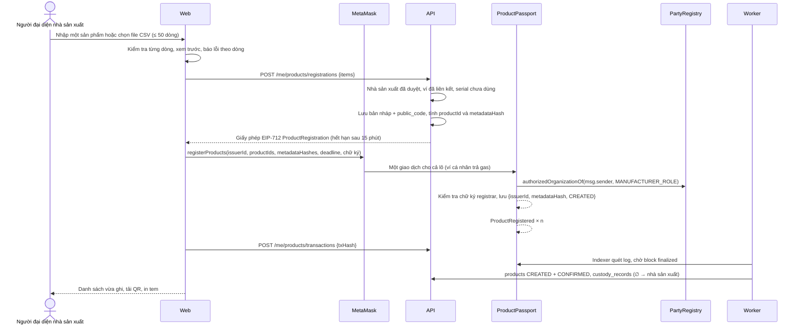

# M5 – Sản phẩm, mã QR và tra cứu

M5 cho nhà sản xuất đã được Admin duyệt (M4) đăng ký sản phẩm lên Monad Testnet và in tem QR; ai cũng quét QR để xem hộ chiếu số của sản phẩm. Như mọi module từ M2, ví MetaMask cá nhân của người đại diện ký và trả gas, hệ thống không có ví riêng.

| UC     | Tên                            | Actor                          | Chạm blockchain                                                                   |
| ------ | ------------------------------ | ------------------------------ | --------------------------------------------------------------------------------- |
| PRD-01 | Tạo sản phẩm                   | Nhà sản xuất                   | Ví cá nhân gọi `registerProducts` với 1 sản phẩm                                  |
| PRD-02 | Nhập danh sách sản phẩm (CSV)  | Nhà sản xuất                   | `registerProducts` với tối đa 50 sản phẩm trong **một** giao dịch                 |
| PRD-03 | Xuất tem QR                    | Nhà sản xuất                   | Không (QR là đường dẫn công khai, không lên chain theo D9)                        |
| VER-01 | Tra cứu hộ chiếu (phần cơ bản) | Bất kỳ ai, không cần đăng nhập | Chỉ đọc `ProductPassport.product()` để đối chiếu; đủ timeline và rate-limit ở M11 |

M5 cũng sửa hai điểm của M4 theo góp ý khi chạy thử (mục 4): lịch sử mọi lần nộp đơn không còn bị mất khi đơn bị từ chối rồi nộp lại, và Admin xem đủ hồ sơ kèm mã giao dịch tra được trên explorer của Monad.

## 1. Quyết định thiết kế

| Mã  | Quyết định                                                                                                                                                                                                                                                                                                                                                                              | Lý do                                                                                                                                                       |
| --- | --------------------------------------------------------------------------------------------------------------------------------------------------------------------------------------------------------------------------------------------------------------------------------------------------------------------------------------------------------------------------------------- | ----------------------------------------------------------------------------------------------------------------------------------------------------------- |
| D31 | **Serial duy nhất trong từng nhà sản xuất**, không duy nhất toàn hệ thống: `UNIQUE (issuer_org_id, serial_number)`, so khớp không phân biệt hoa thường (lưu chữ in hoa). On-chain `productId = keccak256(abi.encode(issuerPartyId, serial))`, nên hai hãng trùng serial vẫn ra hai `productId` khác nhau. Thay cho `serial_number UNIQUE` + `serialHash` của M0.                        | Theo lựa chọn của nhóm: mỗi hãng tự đặt quy tắc serial, hai hãng có thể trùng định dạng.                                                                    |
| D32 | **Một hàm `registerProducts`** cho cả PRD-01 và PRD-02 (1–50 sản phẩm mỗi giao dịch), phát `ProductRegistered` cho từng sản phẩm. Thay cho cặp `createProduct` / `batchCreateProducts` và event `ProductCreated` + `CustodyTransferred` của M0; dòng custody đầu tiên (nhà sản xuất giữ hàng) do Worker ghi từ `ProductRegistered`.                                                     | Một đường code, một bộ test; lô 50 sản phẩm tốn khoảng 3,5 triệu gas (mục 9), nằm xa dưới giới hạn gas mỗi giao dịch của Monad. Bớt một event mỗi sản phẩm. |
| D33 | Contract chỉ nhận lô có **giấy phép EIP-712 `ProductRegistration`** do khoá registrar ký, và `msg.sender` phải là ví đại diện của một nhà sản xuất **đã duyệt** (`PartyRegistry.authorizedOrganizationOf(msg.sender, MANUFACTURER_ROLE)`). Giấy phép gắn `metadataHash` = keccak256 của JSON hồ sơ đã chuẩn hoá (serial, model, mô tả, ngày sản xuất, số tháng bảo hành, nhà sản xuất). | Ví chỉ ghi được đúng hồ sơ đã lưu trong CSDL; sửa hồ sơ sau khi ghi là lộ ngay vì hash lệch. Doanh nghiệp bị khoá thì mất quyền ngay trên contract.         |
| D34 | Hồ sơ lưu thành **bản nháp** trước khi ví ký (`sync_status = PENDING`, `product_state = NULL`). Ví từ chối hoặc mất mạng thì bản nháp vẫn còn: gửi lại với giấy phép mới, hoặc xoá nếu nhập nhầm. Sản phẩm đã lên chain thì không xoá được.                                                                                                                                             | Không mất dữ liệu đã nhập (nhất là lô CSV), không tạo trùng khi gửi lại.                                                                                    |
| D35 | **Mã QR là đường dẫn `/p/<public_code>`**, `public_code` 12 ký tự lấy từ 32 ký tự không gây nhầm (bỏ `I`, `O`, `0`, `1`), hiển thị theo nhóm 4 (`K7M2-PQ9X-RT4W`). Ảnh QR sinh ở trình duyệt (PNG, SVG, trang in tem), không lưu ảnh, không đưa mã lên chain.                                                                                                                           | Theo D9: QR thuộc Main Flow của Create Product, Export QR Labels chỉ là in nhãn. Đọc mã bằng tay cũng không nhầm.                                           |
| D36 | **Hộ chiếu công khai** chỉ có khi sản phẩm đã ghi lên blockchain. Mỗi lần mở trang, API băm lại hồ sơ đang hiển thị và đọc trực tiếp `ProductPassport.product()` để so hash và nhà phát hành; lệch thì báo ngay trên trang. Không trả thông tin cá nhân của người đại diện.                                                                                                             | Người mua kiểm chứng được dữ liệu với blockchain mà không phải tin CSDL.                                                                                    |
| D37 | Bảng mới **`organization_applications`** lưu từng lần nộp đơn doanh nghiệp: bản chụp hồ sơ, `profileHash`, ví nộp, txHash nộp, phí của lần đó, quyết định, lý do, ví Admin và txHash quyết định. Migration dựng lại các lần nộp cũ từ `blockchain_events` đã FINALIZED.                                                                                                                 | `organizations` chỉ giữ hồ sơ hiện hành, nên nộp lại thì lần bị từ chối mất dấu (góp ý của nhóm).                                                           |

## 2. Luồng đăng ký sản phẩm (PRD-01, PRD-02)

Ví từ chối ký ở bước MetaMask thì trang hiện nút **Thử ghi lại lên blockchain** cho đúng các bản nháp vừa lưu (`POST /me/products/registrations/retry`). Nếu giao dịch trước thật ra đã lên chain mà Worker chưa kịp chốt, API không cấp giấy phép gửi lại (tránh revert `ProductAlreadyRegistered`).

Worker đối chiếu từng `ProductRegistered` với CSDL: sản phẩm không có hồ sơ thì tạo cảnh báo `PRODUCT_NOT_IN_DATABASE`; nhà phát hành hoặc hash lệch thì đánh dấu `FAILED`, không công bố hộ chiếu và tạo cảnh báo `PRODUCT_METADATA_MISMATCH` (cả hai mức HIGH, xem ở M12).

## 3. Mã QR và tra cứu (PRD-03, VER-01)

- Trang chi tiết sản phẩm (`/products/<id>`) có mã QR, nút tải **PNG** (in nhanh) và **SVG** (in sắc nét ở mọi cỡ), cùng bằng chứng on-chain: `productId`, `metadataHash`, txHash đăng ký có liên kết sang MonadVision.
- Trang **In tem QR** (`/products/labels?ids=...`) xếp tem theo lưới A4 (QR, mã đọc tay, serial, model); mở từ danh sách sản phẩm (chọn nhiều dòng) hoặc ngay sau khi nhập lô. Header và nút bị ẩn khi in.
- Trang **Tra cứu** (`/lookup`) nhận ba cách: gõ mã (có gạch nối, chữ thường đều được), **quét bằng camera** (điện thoại hoặc webcam) và **tải ảnh chụp tem**. Ba cách đều ra trang hộ chiếu `/p/<mã>`.
- Trang hộ chiếu `/p/<mã>` không cần đăng nhập: thông tin sản phẩm, nhà sản xuất (tên, mã số thuế, trạng thái duyệt), bên đang giữ hàng, kết quả đối chiếu hash và đọc trực tiếp trên chain, lịch sử event có txHash.

Mã QR chứa địa chỉ web đầy đủ. Mặc định là địa chỉ đang mở trên trình duyệt (`http://localhost:3000`), điện thoại không mở được; muốn quét bằng điện thoại trong cùng Wi-Fi thì đặt `PUBLIC_WEB_URL` (mục 8, bước 4). Ô gõ mã vẫn chạy khi trang chưa tải xong JavaScript: form gửi `?code=` và server chuyển thẳng tới hộ chiếu.

## 4. Sửa M4: lịch sử nộp đơn và hồ sơ đầy đủ cho Admin

- Mỗi lần `OrganizationApplied` được Worker ghi thành một dòng `organization_applications` (lần 1, 2, ...). `FeePaid` gắn phí vào đúng lần đó; `OrganizationApproved` / `OrganizationRejected` ghi quyết định, lý do (khớp `reasonHash` on-chain), ví Admin và txHash quyết định. Dòng cũ không bao giờ bị ghi đè.
- Bản chụp hồ sơ chỉ lưu khi hash của hồ sơ trong CSDL khớp `profileHash` on-chain, nên lịch sử hiển thị đúng thứ đã nộp.
- Khu Quản trị: mỗi đơn chờ duyệt hiện **đủ hồ sơ** (tên, loại, mã số thuế, địa chỉ, email và số điện thoại liên hệ, người đại diện, partyId) và đường dẫn **Xem mọi lần nộp đơn và nhật ký on-chain** sang trang `/admin/organizations/<id>`. Trang này có từng lần nộp với bản chụp hồ sơ, ví đã ký, lý do từ chối, phí và **mọi txHash (nộp đơn, quyết định, rút phí hoặc chuyển phí về Treasury) bấm sang MonadVision** (có nút sao chép), cùng nhật ký mọi event on-chain của doanh nghiệp.
- Trang **Doanh nghiệp** của người đại diện cũng hiện các lần nộp trước, nên thấy được lý do bị từ chối ngay cả sau khi đã nộp lại.
- Migration `20261030000000_organization_applications` dựng lại lịch sử cho dữ liệu đã có từ `blockchain_events` FINALIZED và lý do trong `audit_logs`, nên **không cần làm mới CSDL**: các lần bị từ chối trước khi cập nhật M5 vẫn hiện lại.

## 5. Bảng traceability

| UC               | Domain Class                           | Database                                                                            | Smart Contract                                                                              | Event                                                                    |
| ---------------- | -------------------------------------- | ----------------------------------------------------------------------------------- | ------------------------------------------------------------------------------------------- | ------------------------------------------------------------------------ |
| PRD-01           | Product, CustodyRecord                 | products (bản nháp → CREATED, CONFIRMED), custody_records (∅ → nhà sản xuất)        | `ProductPassport.registerProducts(issuerId, [productId], [metadataHash], deadline, chữ ký)` | ProductRegistered                                                        |
| PRD-02           | Product, CustodyRecord                 | như PRD-01, n dòng cùng `created_tx_hash`                                           | `registerProducts` với 1–50 phần tử (`MAX_BATCH_SIZE`)                                      | ProductRegistered × n                                                    |
| PRD-03           | Product (đọc)                          | products.public_code                                                                | —                                                                                           | —                                                                        |
| VER-01           | Product, Organization, các event (đọc) | products, organizations, blockchain_events (`chain_product_id`)                     | View `product(productId)`                                                                   | —                                                                        |
| ORG-01..04 (sửa) | OrganizationApplication                | organization_applications (mỗi lần nộp một dòng, `UNIQUE (organization_id, round)`) | không đổi                                                                                   | OrganizationApplied, FeePaid, OrganizationApproved, OrganizationRejected |

Ràng buộc phía contract: `NotAuthorizedManufacturer` (ví không đại diện nhà sản xuất đã duyệt), `IssuerMismatch`, `InvalidBatchSize` (0 hoặc > 50), `LengthMismatch`, `ProductAlreadyRegistered` (kể cả trùng trong cùng lô), `AuthorizationExpired`, `InvalidAuthorization`. Người đại diện đổi ví (ACC-04) thì ví mới đăng ký được ngay, ví cũ mất quyền (D26).

## 6. API

| Phương thức | Đường dẫn                          | Quyền                 | Mô tả                                                                         |
| ----------- | ---------------------------------- | --------------------- | ----------------------------------------------------------------------------- |
| GET         | `/me/products?filter=&page=`       | Đăng nhập             | Nhà sản xuất đang đại diện, contract, danh sách sản phẩm, đếm bản nháp/đã ghi |
| POST        | `/me/products/registrations`       | Nhà sản xuất đã duyệt | Lưu 1–50 bản nháp, trả giấy phép EIP-712 cho cả lô                            |
| POST        | `/me/products/registrations/retry` | Nhà sản xuất đã duyệt | Cấp giấy phép mới cho các bản nháp chưa lên chain                             |
| POST        | `/me/products/transactions`        | Nhà sản xuất đã duyệt | Báo txHash của `registerProducts`                                             |
| GET         | `/me/products/:id`                 | Nhà sản xuất sở hữu   | Chi tiết, bằng chứng on-chain, lịch sử event                                  |
| DELETE      | `/me/products/:id`                 | Nhà sản xuất sở hữu   | Xoá bản nháp chưa lên chain (đã lên chain trả 409)                            |
| GET         | `/public/products/:code`           | Công khai             | Hộ chiếu công khai theo mã QR                                                 |
| GET         | `/admin/organizations/:id`         | Admin                 | (Sửa M4) Hồ sơ đầy đủ, mọi lần nộp đơn, nhật ký on-chain                      |
| GET         | `/me/organization`                 | Đăng nhập             | (Sửa M4) Thêm `history`: các lần nộp đơn của doanh nghiệp                     |

## 7. File CSV (PRD-02)

Trang **Thêm sản phẩm → Nhập từ file CSV** có nút tải file mẫu. Web đọc được file Excel lưu dạng CSV theo vùng Việt Nam (dấu `;`) lẫn dấu `,`, tiêu đề tiếng Anh hoặc tiếng Việt:

| Cột               | Tiêu đề tiếng Việt | Bắt buộc | Ghi chú                                                    |
| ----------------- | ------------------ | -------- | ---------------------------------------------------------- |
| `serial_number`   | Serial             | Có       | Chữ, số và `- _ . /`, không khoảng trắng, tối đa 100 ký tự |
| `model_name`      | Tên model          | Có       |                                                            |
| `description`     | Mô tả              | Không    | Có dấu phẩy thì đặt trong ngoặc kép                        |
| `manufactured_on` | Ngày sản xuất      | Có       | `DD/MM/YYYY` hoặc `YYYY-MM-DD`, không sau hôm nay, từ 1990 |
| `warranty_months` | Bảo hành (tháng)   | Có       | 0–120; 0 là không bảo hành                                 |

Lỗi hiện theo từng dòng (thiếu tên, ngày sai, serial có khoảng trắng, serial trùng trong file); serial đã có trong hệ thống thì API báo đúng serial đó. Hết lỗi mới bấm ghi được, cả file đi trong một giao dịch.

## 8. Cài đặt khi cập nhật từ M4

PartyRegistry **giữ nguyên**, chỉ deploy thêm ProductPassport, nên **không làm mới CSDL**:

1. `pnpm install` (thêm `qrcode` và `jsqr` cho web).
2. `pnpm db:deploy` và `pnpm --filter @dpp/api db:deploy:test`. Hai migration mới: `20261030000000_organization_applications` (kèm dựng lại lịch sử nộp đơn) và `20261030010000_product_registration`.
3. `pnpm --filter @dpp/contracts deploy:products:monad` (nhập mật khẩu keystore). Script đọc `PARTY_REGISTRY_ADDRESS` trong `.env`, deploy vào thư mục Ignition `chain-10143-products-v1` và in hai dòng `PRODUCT_PASSPORT_ADDRESS`, `PRODUCT_PASSPORT_DEPLOY_BLOCK`: thêm vào `.env`, mỗi biến một dòng.
4. (Tuỳ chọn) quét QR bằng điện thoại cùng Wi-Fi: `pnpm dev` in ra dòng `Network: http://192.168.x.x:3000`; đặt `PUBLIC_WEB_URL` bằng địa chỉ đó trong `.env` rồi khởi động lại `pnpm dev`. Biến này vừa đổi địa chỉ in trong QR, vừa cho máy chủ dev của Next.js nhận trang mở từ điện thoại (thiếu thì trang hiện nhưng nút bấm không chạy). Windows hỏi tường lửa cho Node.js thì chọn cho phép mạng Private. Camera trong trang Tra cứu chỉ bật được qua HTTPS hoặc `localhost`; trên điện thoại dùng ứng dụng camera có sẵn để quét tem, hoặc chụp tem rồi tải ảnh lên.
5. Khởi động lại `pnpm dev`. Mục **Sản phẩm** hiện trên menu khi tài khoản đại diện một nhà sản xuất.

Chạy cục bộ trên Hardhat node: sau `deploy:local` chạy `pnpm --filter @dpp/contracts deploy:products:local`.

## 9. Gas

Đo trên Hardhat node khi chạy thử giao diện (Monad định giá opcode khác; số liệu chính thức đo trên testnet ở M13). Web đặt gas limit bằng ước lượng cộng 10%.

| Lô                   | Gas đã dùng | Trung bình mỗi sản phẩm |
| -------------------- | ----------- | ----------------------- |
| 1 sản phẩm (PRD-01)  | 114.606     | 114.606                 |
| 10 sản phẩm (PRD-02) | 743.687     | 74.369                  |
| 50 sản phẩm (tối đa) | 3.539.821   | 70.796                  |

Gửi theo lô rẻ hơn khoảng 38% mỗi sản phẩm so với gửi lẻ, và chỉ cần ký một lần.

## 10. Test chứng minh

| Test                                                                     | Chứng minh                                                                                                                    |
| ------------------------------------------------------------------------ | ----------------------------------------------------------------------------------------------------------------------------- |
| `packages/contracts/test/product/product-passport.test.ts`               | 12 ca: một sản phẩm, lô 50, lô sai cỡ, chỉ nhà sản xuất đã duyệt, bị khoá, giấy phép sai/hết hạn, trùng productId, đổi ví     |
| `apps/api/src/modules/products/application/product-registration.spec.ts` | Bản nháp chuẩn hoá, lô giữ thứ tự, quyền, serial trùng theo từng hãng, sinh lại mã QR trùng, gửi lại, xoá                     |
| `apps/api/src/modules/products/application/product-projection.spec.ts`   | `ProductRegistered` thành CREATED + custody đầu tiên; lệch hồ sơ thì FAILED và cảnh báo                                       |
| `apps/api/test/products/products.e2e-spec.ts`                            | Trọn luồng trên Hardhat node: duyệt nhà sản xuất, PRD-01, lô CSV, Indexer chốt khi web không báo, tra cứu công khai đọc chain |
| `apps/api/test/organizations/organizations.e2e-spec.ts`                  | Từ chối rồi nộp lại vẫn giữ lần 1 với lý do, phí và txHash                                                                    |
| `apps/api/test/database/application-backfill.e2e-spec.ts`                | Migration dựng lại đúng các lần nộp đơn từ event cũ                                                                           |
| `apps/api/test/database/schema-constraints.e2e-spec.ts`                  | Serial duy nhất theo hãng, mẫu serial, bảo hành 0–120 tháng, ngày sản xuất, mỗi doanh nghiệp tối đa một đơn chờ duyệt         |
| `packages/shared/src/domain/product-metadata.spec.ts`                    | productId theo hãng, hash hồ sơ ổn định, đọc mã QR từ mã trần hoặc đường dẫn                                                  |
| `apps/web/src/features/products/product-csv.spec.ts`                     | Đọc CSV của Excel, báo lỗi theo dòng, giới hạn 50 dòng                                                                        |

## 11. Giới hạn

- Sản phẩm đã ghi lên blockchain không sửa hồ sơ được (hash đã khoá); nhập sai thì cần nghiệp vụ thu hồi ở M10.
- Mỗi giao dịch tối đa 50 sản phẩm; file lớn hơn thì chia nhiều file.
- Tra cứu công khai chưa giới hạn số lần gọi và chưa có timeline đầy đủ (phân phối, bảo hành, chuyển quyền): làm ở M11 khi các module đó có dữ liệu.
- Quét camera trên trình duyệt cần HTTPS hoặc `localhost` (quy định của trình duyệt).
