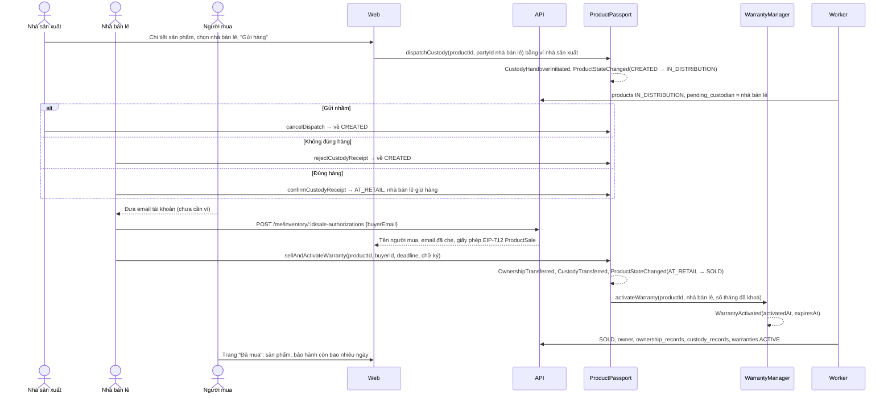

# M6 – Phân phối, bán hàng và kích hoạt bảo hành

M6 nối nhà sản xuất với nhà bán lẻ và người mua: nhà sản xuất gửi hàng, nhà bán lẻ xác nhận đã nhận, rồi bán cho tài khoản của người mua và bảo hành bắt đầu ngay trong giao dịch bán. Như mọi module từ M2, ví MetaMask cá nhân của người đại diện ký và trả gas; người mua chỉ cần tài khoản web.

| UC     | Tên                                 | Actor                  | Chạm blockchain                                                         |
| ------ | ----------------------------------- | ---------------------- | ----------------------------------------------------------------------- |
| DST-01 | Gửi hàng (Dispatch Custody)         | Nhà sản xuất           | `dispatchCustody(productId, partyId nhà bán lẻ)`; huỷ: `cancelDispatch` |
| DST-02 | Nhận hàng (Confirm Custody Receipt) | Nhà bán lẻ             | `confirmCustodyReceipt`; từ chối: `rejectCustodyReceipt`                |
| DST-03 | Bán và kích hoạt bảo hành           | Nhà bán lẻ             | `sellAndActivateWarranty` → `WarrantyManager.activateWarranty`          |
| —      | Xem sản phẩm đã mua                 | Người mua (chủ sở hữu) | Chỉ đọc                                                                 |

## 1. Quyết định thiết kế

| Mã  | Quyết định                                                                                                                                                                                                                                                                                                                                                                                                                                        | Lý do                                                                                                 |
| --- | ------------------------------------------------------------------------------------------------------------------------------------------------------------------------------------------------------------------------------------------------------------------------------------------------------------------------------------------------------------------------------------------------------------------------------------------------- | ----------------------------------------------------------------------------------------------------- |
| D38 | **Deploy ProductPassport phiên bản 2** thay cho bản M5 (contract đã deploy không thêm hàm được). Một contract giữ cả định danh, trạng thái, bên giữ hàng và chủ sở hữu như bảng traceability M0. Bản M5 vẫn nằm trên chain và trong thư mục Ignition `chain-10143-products-v1`; sản phẩm test của M5 được dọn bằng `products:reset` rồi nhập lại. EIP-712 đổi phiên bản thành `"2"`.                                                              | Theo lựa chọn của nhóm: đúng M0, có sẵn chỗ cho M7, M9, M10 nên không phải deploy lại nữa.            |
| D39 | **Giao hàng 2 bước, từng sản phẩm** (D7): gửi → IN_DISTRIBUTION, chờ nhà bán lẻ; bên giữ hàng chỉ đổi khi nhà bán lẻ xác nhận (AT_RETAIL). Nhà sản xuất **huỷ** được khi bên kia chưa nhận (gửi nhầm), nhà bán lẻ **từ chối** được nếu không đúng hàng; cả hai đưa sản phẩm về CREATED, lịch sử giữ đủ event.                                                                                                                                     | Theo lựa chọn của nhóm; tránh sản phẩm kẹt ở "Đang vận chuyển".                                       |
| D40 | **Người mua là tài khoản web, chưa cần ví**: nhà bán lẻ nhập email, backend ký giấy phép EIP-712 `ProductSale(productId, retailerId, buyerId, deadline)` gắn đúng partyId của tài khoản đó. Contract còn từ chối bán cho Party là tổ chức. Ví của người mua chỉ cần khi họ tự làm giao dịch (chuyển nhượng M9, bảo hành M7).                                                                                                                      | Bán tại quầy không bắt khách cài MetaMask; quyền sở hữu vẫn gắn với danh tính có thật trong hệ thống. |
| D41 | **Số tháng bảo hành khoá on-chain lúc đăng ký**: `registerProducts` nhận thêm `warrantyMonths[]` (nằm trong giấy phép EIP-712 và hash hồ sơ). Khi bán, contract tự dùng con số này; nhà bán lẻ không đổi được. 0 tháng thì không kích hoạt bảo hành.                                                                                                                                                                                              | Theo lựa chọn của nhóm: bảo hành do nhà sản xuất cam kết.                                             |
| D42 | **Hạn bảo hành theo tháng lịch Việt Nam (UTC+7)**: thư viện `VietnamCalendar` trong contract cộng tháng như trên hoá đơn (bán 15/10/2026, 24 tháng → hết hạn 15/10/2028, ngày 31 thì lấy ngày cuối tháng). Hết hạn không cần giao dịch: `effectiveWarrantyState` suy ra theo thời gian (D10), Worker đồng bộ cột `warranty_state` mỗi 10 phút.                                                                                                    | Hạn trên chain khớp ngày người mua đọc trên giấy tờ; không tốn giao dịch khi hết hạn.                 |
| D43 | Khi bán, **người mua vừa là chủ sở hữu vừa giữ hàng** (OwnershipTransferred ∅ → người mua, CustodyTransferred nhà bán lẻ → người mua).                                                                                                                                                                                                                                                                                                            | Custody và ownership vẫn tách riêng trong dữ liệu; sau khi bán thì cùng một người.                    |
| D44 | Mỗi bước sau đăng ký phát thêm **`ProductStateChanged(trạng thái trước, trạng thái sau)`**. Indexer đối chiếu với trạng thái vừa chiếu vào CSDL; lệch thì cảnh báo `PRODUCT_STATE_MISMATCH`. Event của Party lạ (bên nhận, người mua không có trong CSDL) cũng không ghi bừa mà cảnh báo `PRODUCT_PARTY_UNKNOWN`.                                                                                                                                 | Mỗi lần chuyển trạng thái của state machine đều có txHash riêng để tra; CSDL không lệch âm thầm.      |
| D45 | **Điểm nối cho module sau** qua role trên PartyRegistry (Admin cấp cho địa chỉ contract): `TRANSFER_CONTRACT_ROLE` gọi `transferOwnership` (M9), `LIFECYCLE_CONTRACT_ROLE` gọi `setLifecycleState` sang RECALLED, LOST_STOLEN, RETIRED (M10), `SERVICE_CONTRACT_ROLE` tạm dừng/tiếp tục bảo hành (M7). ProductPassport có `PRODUCT_CONTRACT_ROLE` để kích hoạt bảo hành (cấp ngay khi deploy). Admin đổi được WarrantyManager nếu M7 cần bản mới. | Module sau thêm contract riêng, không phải deploy lại ProductPassport và không mất dữ liệu sản phẩm.  |
| D46 | **Không lộ người mua**: hộ chiếu công khai và màn hình của nhà sản xuất, nhà bán lẻ chỉ ghi "Người dùng cá nhân"; người mua thấy "Bạn". Nhà bán lẻ chỉ thấy tên và email đã che (`t***@gmail.com`) lúc xác nhận bán.                                                                                                                                                                                                                              | Đúng yêu cầu VER-01 "không trả PII của owner".                                                        |

## 2. Luồng giao hàng và bán (DST-01..03)



## 3. Bảng traceability

| UC     | Domain Class                                      | Database                                                                                                     | Smart Contract                                                                                                                              | Event                                                                                            |
| ------ | ------------------------------------------------- | ------------------------------------------------------------------------------------------------------------ | ------------------------------------------------------------------------------------------------------------------------------------------- | ------------------------------------------------------------------------------------------------ |
| DST-01 | Product                                           | products (IN_DISTRIBUTION, pending_custodian_party_id)                                                       | `dispatchCustody(productId, toPartyId)`; `cancelDispatch(productId)`                                                                        | CustodyHandoverInitiated / CustodyHandoverCancelled, ProductStateChanged                         |
| DST-02 | Product, CustodyRecord                            | products (AT_RETAIL, current_custodian_party_id), custody_records                                            | `confirmCustodyReceipt(productId)`; `rejectCustodyReceipt(productId)`                                                                       | CustodyTransferred / CustodyHandoverRejected, ProductStateChanged                                |
| DST-03 | Product, OwnershipRecord, CustodyRecord, Warranty | products (SOLD, current_owner_party_id), ownership_records (from NULL), custody_records, warranties (ACTIVE) | `sellAndActivateWarranty(productId, buyerId, deadline, authorization)` → `WarrantyManager.activateWarranty(productId, activatedBy, months)` | OwnershipTransferred (∅ → người mua), CustodyTransferred, ProductStateChanged, WarrantyActivated |

Điều kiện contract kiểm tra (mỗi điều kiện có một ca test): bên gửi là ví đại diện nhà sản xuất đang giữ hàng (`NotAuthorizedManufacturer`, `NotCustodian`); bên nhận là nhà bán lẻ đã duyệt (`RecipientNotRetailer`); chỉ nhà bán lẻ được gửi tới mới nhận/từ chối (`NotPendingCustodian`); chỉ nhà bán lẻ đang giữ hàng mới bán (`NotAuthorizedRetailer`, `NotCustodian`); sai trạng thái thì `InvalidStateTransition(hiện tại, đích)`; giấy phép bán sai người mua, sai cửa hàng, hết hạn thì `InvalidAuthorization`, `AuthorizationExpired`; bán cho tổ chức thì `InvalidBuyer`.

State machine sản phẩm sau M6 (bảng trong `packages/shared/src/domain/state-machines.ts`):

```text
CREATED ──dispatch──▶ IN_DISTRIBUTION ──confirm──▶ AT_RETAIL ──sell──▶ SOLD
   ▲                        │
   └──── cancel / reject ───┘
```

## 4. Màn hình

- **Sản phẩm** (nhà sản xuất), trang chi tiết: khung **Phân phối** chọn nhà bán lẻ đã duyệt (kèm MST, địa chỉ) rồi **Gửi hàng**; đang gửi thì có **Huỷ gửi (gửi nhầm)**. Danh sách sản phẩm ghi sản phẩm đang ở đâu.
- **Kho hàng** (`/inventory`, nhà bán lẻ): ba tab Chờ nhận, Đang bán, Đã bán. Chờ nhận có nút **Đã nhận hàng** và **Từ chối** ngay trên dòng. Trang chi tiết có form **Bán cho người mua**: nhập email → **Kiểm tra người mua** → hiện tên và email đã che → **Xác nhận bán và kích hoạt bảo hành**.
- **Đã mua** (`/owned`, mọi tài khoản không đại diện tổ chức hoặc đã có hàng): sản phẩm đang sở hữu, bảo hành đến ngày nào, còn bao nhiêu ngày.
- **Hộ chiếu công khai** `/p/<mã>`: bên đang giữ, đã có chủ hay chưa, bảo hành, hành trình chia tab Phân phối, Bảo hành, Chuyển nhượng; mỗi bước có txHash bấm sang MonadVision.
- **Lịch sử on-chain** trên các trang chi tiết ghi từng lần **Chuyển trạng thái: A → B**.

## 5. API

| Phương thức | Đường dẫn                                       | Quyền                 | Mô tả                                                                                     |
| ----------- | ----------------------------------------------- | --------------------- | ----------------------------------------------------------------------------------------- |
| GET         | `/me/workspace`                                 | Đăng nhập             | Tổ chức đang đại diện và số sản phẩm đang sở hữu (dựng menu)                              |
| GET         | `/me/retailers`                                 | Nhà sản xuất đã duyệt | Nhà bán lẻ đã duyệt để chọn khi gửi hàng                                                  |
| POST        | `/me/products/transactions`                     | Nhà sản xuất đã duyệt | Báo txHash của `registerProducts`, `dispatchCustody`, `cancelDispatch`                    |
| GET         | `/me/inventory?filter=INCOMING\|IN_STOCK\|SOLD` | Đăng nhập             | Kho hàng của nhà bán lẻ, đếm theo tab                                                     |
| GET         | `/me/inventory/:id`                             | Nhà bán lẻ liên quan  | Chi tiết, bảo hành, hành trình, bằng chứng on-chain                                       |
| POST        | `/me/inventory/:id/sale-authorizations`         | Nhà bán lẻ đã duyệt   | `{ buyerEmail }` → giấy phép EIP-712 ProductSale                                          |
| POST        | `/me/inventory/transactions`                    | Nhà bán lẻ đã duyệt   | Báo txHash của `confirmCustodyReceipt`, `rejectCustodyReceipt`, `sellAndActivateWarranty` |
| GET         | `/me/owned-products`, `/me/owned-products/:id`  | Chủ sở hữu            | Sản phẩm đang sở hữu, chi tiết                                                            |
| GET         | `/public/products/:code`                        | Công khai             | Thêm `holder`, `pendingRetailer`, `hasOwner`, `warranty`, `journey`                       |

Báo txHash sai vai trò (nhà bán lẻ báo giao dịch gửi hàng của nhà sản xuất) bị từ chối với 422.

## 6. Cài đặt khi cập nhật từ M5

M6 **không có migration mới** (các bảng `custody_records`, `ownership_records`, `warranties` đã có từ M1). Tài khoản, ví, doanh nghiệp giữ nguyên; chỉ sản phẩm test của M5 phải nhập lại vì thuộc ProductPassport cũ.

1. Tắt `pnpm dev`. Giải nén, `pnpm install`.
2. `pnpm --filter @dpp/contracts deploy:products:monad` (nhập mật khẩu keystore). Ví deploy phải còn quyền Admin trên PartyRegistry (đúng ví đã deploy PartyRegistry) vì script cấp `PRODUCT_CONTRACT_ROLE` cho ProductPassport mới. Deploy vào thư mục Ignition `chain-10143-products-v2`, in ba dòng: **thay** `PRODUCT_PASSPORT_ADDRESS`, `PRODUCT_PASSPORT_DEPLOY_BLOCK` và **thêm** `WARRANTY_MANAGER_ADDRESS` trong `.env`.
3. `pnpm --filter @dpp/api products:reset` để xem số dòng sẽ xoá, rồi `pnpm --filter @dpp/api products:reset --yes`. Lệnh xoá sản phẩm và dữ liệu đi kèm (custody, ownership, bảo hành, cảnh báo của sản phẩm); `blockchain_events` và `audit_logs` giữ làm hồ sơ (event của contract cũ không hiện lẫn vào lịch sử sản phẩm mới).
4. `pnpm dev`, nhập lại sản phẩm (CSV).
5. Tạo thêm một doanh nghiệp loại **Nhà bán lẻ** (tài khoản khác, ví MetaMask khác, Admin duyệt) và một tài khoản người mua (không cần liên kết ví).

Chạy cục bộ: sau `deploy:local` chạy `deploy:products:local`, chép ba dòng in ra.

## 7. Gas

Đo trên Hardhat (Monad định giá opcode khác; số liệu chính thức ở M13). Web đặt gas limit bằng ước lượng cộng 10%.

| Hàm                                              | Gas đã dùng                   |
| ------------------------------------------------ | ----------------------------- |
| `registerProducts` 1 / 10 / 50 sản phẩm          | 116.606 / 753.032 / 3.581.628 |
| `dispatchCustody`                                | 75.441                        |
| `cancelDispatch`                                 | 48.026                        |
| `rejectCustodyReceipt`                           | 47.966                        |
| `confirmCustodyReceipt`                          | 67.963                        |
| `sellAndActivateWarranty` (có bảo hành 24 tháng) | 147.516                       |
| `sellAndActivateWarranty` (không bảo hành)       | 85.375                        |

Đăng ký tăng khoảng 2.000 gas mỗi lô so với M5 vì lưu thêm số tháng bảo hành; bên giữ hàng không ghi lúc đăng ký (lưu 0, hàm view trả nhà sản xuất) để không tốn thêm một ô lưu trữ mỗi sản phẩm.

## 8. Test chứng minh

| Test                                                                     | Chứng minh                                                                                                                                                |
| ------------------------------------------------------------------------ | --------------------------------------------------------------------------------------------------------------------------------------------------------- |
| `packages/contracts/test/product/product-distribution.test.ts`           | 16 ca: gửi, huỷ, từ chối, nhận, bán, mọi điều kiện revert, giấy phép bán, không bán cho tổ chức, điểm nối M9/M10, đổi WarrantyManager                     |
| `packages/contracts/test/warranty/warranty-manager.test.ts`              | Chỉ ProductPassport kích hoạt, 1–120 tháng, hết hạn theo thời gian, tạm dừng/tiếp tục (M7), lịch Việt Nam khớp `addWarrantyMonths` trên 120 mốc thời gian |
| `packages/contracts/test/product/product-passport.test.ts`               | Đăng ký v2: số tháng bảo hành nằm trong giấy phép, tối đa 120                                                                                             |
| `apps/api/src/modules/products/application/product-projection.spec.ts`   | Chiếu từng bước vào CSDL, cảnh báo khi Party lạ hoặc trạng thái lệch, trạng thái vòng đời M10                                                             |
| `apps/api/src/modules/products/application/product-distribution.spec.ts` | Giấy phép bán đúng người mua, kho hàng, trang Đã mua, hộ chiếu không lộ người mua                                                                         |
| `apps/api/test/products/distribution.e2e-spec.ts`                        | Trọn luồng trên Hardhat node: gửi → từ chối → gửi → huỷ → gửi → nhận → bán → bảo hành → hành trình 9 bước                                                 |
| `packages/shared/src/chain/warranty-manager.spec.ts`                     | Cộng tháng theo giờ Việt Nam, ngày cuối tháng, năm nhuận                                                                                                  |

## 9. Giới hạn

- Gửi, nhận và bán từng sản phẩm một (theo lựa chọn của nhóm); lô lớn cần nhiều giao dịch.
- Từ chối nhận hàng chưa kèm lý do; lịch sử chỉ ghi ai từ chối và lúc nào.
- Người mua phải có tài khoản trước khi bán; chưa có luồng mã nhận hàng cho khách vãng lai.
- Nhà bán lẻ đã nhận hàng chưa trả lại được nhà sản xuất; đã bán thì không huỷ được (đổi trả để module sau).
