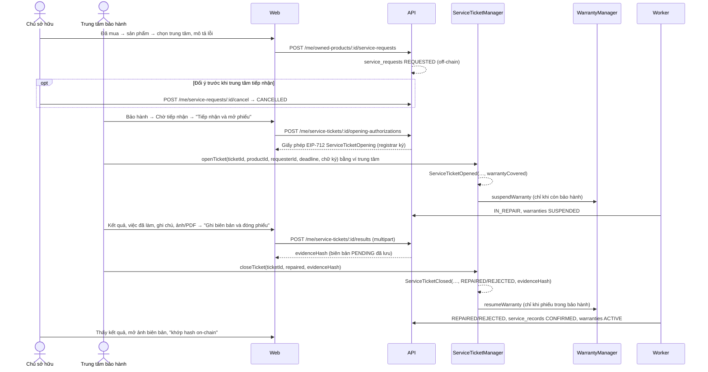

# M7 – Dịch vụ bảo hành và phiếu sửa chữa

M7 nối chủ sở hữu với trung tâm bảo hành: chủ sở hữu gửi yêu cầu trên web (không cần ví), trung tâm tiếp nhận và mở phiếu trên blockchain, sửa xong thì ghi biên bản và đóng phiếu. Còn bảo hành thì bảo hành tạm dừng trong lúc sửa và tiếp tục khi đóng phiếu. Như các module trước, ví MetaMask cá nhân của người đại diện trung tâm ký và trả gas.

| UC     | Tên                                        | Actor              | Chạm blockchain                                                                                  |
| ------ | ------------------------------------------ | ------------------ | ------------------------------------------------------------------------------------------------ |
| SVC-01 | Gửi yêu cầu bảo hành, sửa chữa             | Chủ sở hữu         | Không (off-chain)                                                                                |
| SVC-02 | Huỷ yêu cầu chưa tiếp nhận                 | Chủ sở hữu         | Không (off-chain)                                                                                |
| SVC-03 | Tiếp nhận, mở phiếu sửa; tạm dừng bảo hành | Trung tâm bảo hành | `ServiceTicketManager.openTicket` → `WarrantyManager.suspendWarranty` (khi còn bảo hành)         |
| SVC-04 | Ghi kết quả kèm hash biên bản, đóng phiếu  | Trung tâm bảo hành | `ServiceTicketManager.closeTicket` → `WarrantyManager.resumeWarranty` (khi phiếu trong bảo hành) |

## 1. Quyết định thiết kế

| Mã  | Quyết định                                                                                                                                                                                                                                                                                                                                                                                                                                                                                                                                                            | Lý do                                                                                     |
| --- | --------------------------------------------------------------------------------------------------------------------------------------------------------------------------------------------------------------------------------------------------------------------------------------------------------------------------------------------------------------------------------------------------------------------------------------------------------------------------------------------------------------------------------------------------------------------- | ----------------------------------------------------------------------------------------- |
| D47 | **Chủ sở hữu gửi yêu cầu trên web, không cần ví**: chọn một trung tâm bảo hành đã duyệt và mô tả lỗi. REQUESTED và CANCELLED chỉ nằm trong CSDL (D7); chưa tiếp nhận thì chủ sở hữu huỷ được. Mỗi sản phẩm tối đa một yêu cầu đang mở (`ux_service_one_open`).                                                                                                                                                                                                                                                                                                        | Theo lựa chọn của nhóm; người mua tại quầy (D40) không phải cài MetaMask.                 |
| D48 | **Contract mới `ServiceTicketManager`**, không deploy lại ProductPassport (dùng điểm nối D45). Mở phiếu cần **giấy phép EIP-712 `ServiceTicketOpening(ticketId, productId, serviceCenterId, requesterId, deadline)`** do registrar ký: backend chỉ ký khi đúng chủ sở hữu đã chọn đúng trung tâm cho đúng sản phẩm. `ticketId` = UUID của yêu cầu (16 byte thấp), mỗi ticketId chỉ mở được một lần nên giấy phép không dùng lại được. Contract còn kiểm tra sản phẩm SOLD, `requesterId` là chủ hiện tại, mỗi sản phẩm một phiếu mở.                                  | Trung tâm không tự mở phiếu và tạm dừng bảo hành sản phẩm của người khác được.            |
| D49 | **Còn bảo hành lúc mở phiếu thì tạm dừng bảo hành, đóng phiếu thì tiếp tục; không cộng thêm thời gian sửa.** Hết hạn trong lúc sửa thì đóng phiếu vẫn được, bảo hành là EXPIRED (D10).                                                                                                                                                                                                                                                                                                                                                                                | Theo lựa chọn của nhóm; giữ nguyên WarrantyManager của M6.                                |
| D50 | **Sản phẩm hết hoặc không có bảo hành vẫn sửa được**, phiếu ghi `warrantyCovered = false` ("ngoài bảo hành") và không gọi WarrantyManager.                                                                                                                                                                                                                                                                                                                                                                                                                            | Theo lựa chọn của nhóm; lịch sử sửa chữa đủ cả hai loại.                                  |
| D51 | **Biên bản = nội dung + file ảnh/PDF (không bắt buộc)**. File lưu trên máy chủ API (`UPLOAD_DIR`, không commit, không phục vụ công khai), khoá file theo sha256. Hash ghi on-chain: `keccak256(JSON{version, ticketId, repaired, actionCode, actionDetail, file{sha256, mimeType}})` (hàm `serviceEvidenceHash` ở `@dpp/shared`). API kiểm tra loại file theo byte đầu (JPEG, PNG, WebP, PDF), tối đa 5 MB.                                                                                                                                                           | Theo lựa chọn của nhóm; sửa nội dung hoặc thay file sau khi đóng phiếu đều làm lệch hash. |
| D52 | **Trung tâm không từ chối off-chain**: không nhận sửa thì vẫn mở phiếu rồi đóng với kết quả **Không sửa được** (REJECTED), để lần tiếp nhận nào cũng có dấu vết on-chain.                                                                                                                                                                                                                                                                                                                                                                                             | Tránh yêu cầu bị bỏ lơ không ai biết.                                                     |
| D53 | **Worker chiếu event**: `ServiceTicketOpened` → IN_REPAIR (ghi `chain_ticket_id`, `warranty_covered`, `opened_at`, `open_tx_hash`); `ServiceTicketClosed` → REPAIRED/REJECTED và biên bản PENDING có đúng hash thành CONFIRMED. Cảnh báo: `SERVICE_TICKET_UNKNOWN` (ticketId, sản phẩm hoặc trung tâm không khớp), `SERVICE_EVIDENCE_MISMATCH` (hash on-chain không do hệ thống lưu), `SERVICE_TICKET_CONFLICT` (chủ sở hữu huỷ đúng lúc trung tâm mở phiếu: chain thắng, phiếu vẫn mở). Tạm dừng, tiếp tục bảo hành do projector WarrantyManager có sẵn từ M6 chiếu. | Chain là nguồn sự thật; CSDL không lệch âm thầm.                                          |
| D54 | **Không lộ thông tin riêng**: hộ chiếu công khai chỉ có bước "Tiếp nhận sửa chữa" (trung tâm, trong/ngoài bảo hành) và "Sửa xong/Không sửa được" kèm txHash, không có mô tả lỗi, ghi chú hay file. File biên bản chỉ trung tâm của phiếu và chủ sở hữu đã gửi yêu cầu tải được. Trung tâm thấy tên và email đã che của chủ sở hữu.                                                                                                                                                                                                                                    | Đúng VER-01; biên bản có thể chứa thông tin cá nhân.                                      |

## 2. Luồng bảo hành (SVC-01..04)



## 3. Bảng traceability

| UC     | Domain Class                            | Database                                                                                                       | Smart Contract                                                          | Event                                  |
| ------ | --------------------------------------- | -------------------------------------------------------------------------------------------------------------- | ----------------------------------------------------------------------- | -------------------------------------- |
| SVC-01 | ServiceRequest                          | service_requests (REQUESTED)                                                                                   | —                                                                       | —                                      |
| SVC-02 | ServiceRequest                          | service_requests (CANCELLED, cancelled_at)                                                                     | —                                                                       | —                                      |
| SVC-03 | ServiceRequest, Warranty                | service_requests (IN_REPAIR, chain_ticket_id, warranty_covered), warranties (SUSPENDED)                        | `openTicket(ticketId, productId, requesterId, deadline, authorization)` | ServiceTicketOpened, WarrantySuspended |
| SVC-04 | ServiceRequest, ServiceRecord, Warranty | service_requests (REPAIRED/REJECTED), service_records (CONFIRMED, evidence_hash, tx_hash), warranties (ACTIVE) | `closeTicket(ticketId, repaired, evidenceHash)`                         | ServiceTicketClosed, WarrantyResumed   |

Điều kiện contract kiểm tra (mỗi điều kiện có ca test): ví là đại diện trung tâm bảo hành đã duyệt (`NotAuthorizedServiceCenter`); ticketId chưa dùng (`TicketAlreadyExists`); sản phẩm chưa có phiếu mở (`ProductHasOpenTicket`); sản phẩm đã bán (`ProductNotOwned`); người yêu cầu là chủ hiện tại (`RequesterNotOwner`); giấy phép đúng registrar, đúng trung tâm, còn hạn (`InvalidAuthorization`, `AuthorizationExpired`); chỉ trung tâm đã mở mới đóng (`NotTicketServiceCenter`); phiếu đang mở (`TicketNotOpen`); hash biên bản khác 0.

State machine phiếu (bảng `SERVICE_STATE_TRANSITIONS` trong `packages/shared/src/domain/state-machines.ts`):

```text
REQUESTED ──openTicket──▶ IN_REPAIR ──closeTicket(true)──▶ REPAIRED
    │                          └──────closeTicket(false)──▶ REJECTED
    └──huỷ (off-chain)──▶ CANCELLED
```

## 4. Màn hình

- **Đã mua → chi tiết sản phẩm** (chủ sở hữu): khung **Bảo hành và sửa chữa** chọn trung tâm, mô tả lỗi, **Gửi yêu cầu bảo hành**; danh sách các lần sửa với trạng thái, **Huỷ yêu cầu** khi chưa tiếp nhận, kết quả, việc đã làm, **Xem ảnh/Mở file PDF** và dòng "Băm lại biên bản khớp hash đã ghi on-chain". Khung Bảo hành hiện **Tạm dừng khi sửa** trong lúc sửa.
- **Bảo hành** (`/service`, chỉ hiện với người đại diện trung tâm bảo hành): ba tab Chờ tiếp nhận, Đang sửa, Đã đóng.
- **Phiếu** (`/service/<id>`): yêu cầu của chủ sở hữu (tên, email đã che, mô tả lỗi), bảo hành còn bao nhiêu ngày; nút **Tiếp nhận và mở phiếu**; khi đang sửa có form **Ghi kết quả và đóng phiếu** (Đã sửa xong / Không sửa được, việc đã làm, ghi chú kỹ thuật, ảnh hoặc PDF); nhật ký on-chain của phiếu.
- **Hộ chiếu công khai**: tab **Bảo hành** thêm bước "Tiếp nhận sửa chữa" và "Sửa xong"/"Không sửa được", mỗi bước có txHash.

## 5. API

| Phương thức | Đường dẫn                                                 | Quyền                                  | Mô tả                                                                                  |
| ----------- | --------------------------------------------------------- | -------------------------------------- | -------------------------------------------------------------------------------------- |
| GET         | `/me/owned-products/:id/service`                          | Chủ sở hữu                             | Trung tâm đã duyệt để chọn, lý do không gửi được (nếu có), các yêu cầu đã gửi          |
| POST        | `/me/owned-products/:id/service-requests`                 | Chủ sở hữu                             | `{ serviceCenterOrgId, issueDesc }` → yêu cầu REQUESTED                                |
| POST        | `/me/service-requests/:id/cancel`                         | Người gửi yêu cầu                      | Huỷ khi còn REQUESTED (204)                                                            |
| GET         | `/me/service-requests/:id/evidence`                       | Trung tâm của phiếu, người gửi yêu cầu | Tải file biên bản (`nosniff`, `no-store`)                                              |
| GET         | `/me/service-tickets?filter=REQUESTED\|IN_REPAIR\|CLOSED` | Đăng nhập                              | Phiếu của trung tâm, đếm theo tab                                                      |
| GET         | `/me/service-tickets/:id`                                 | Trung tâm của phiếu                    | Chi tiết, chủ sở hữu (email che), bảo hành, biên bản, đối chiếu hash, nhật ký on-chain |
| POST        | `/me/service-tickets/:id/opening-authorizations`          | Trung tâm đã duyệt, có ví              | Giấy phép EIP-712 ServiceTicketOpening (hạn 15 phút)                                   |
| POST        | `/me/service-tickets/:id/results`                         | Trung tâm đã duyệt, có ví              | multipart: `repaired`, `actionCode`, `actionDetail`, file `evidence` → `evidenceHash`  |
| POST        | `/me/service-tickets/transactions`                        | Trung tâm đã duyệt, có ví              | Báo txHash của `openTicket`, `closeTicket`                                             |

`actionCode`: `REPAIR`, `REPLACE_PART`, `SOFTWARE_UPDATE`, `CLEANING`, `INSPECTION_ONLY`, `OTHER`. Báo txHash sai vai trò (nhà bán lẻ báo giao dịch của trung tâm) bị từ chối với 403.

## 6. Gas

Đo trên Hardhat (Monad định giá opcode khác; số liệu chính thức ở M13). Web đặt gas limit bằng ước lượng cộng 10%.

| Hàm                                               | Gas đã dùng |
| ------------------------------------------------- | ----------- |
| `openTicket` (còn bảo hành, tạm dừng bảo hành)    | 183.736     |
| `openTicket` (ngoài bảo hành)                     | 174.721     |
| `closeTicket` (trong bảo hành, tiếp tục bảo hành) | 82.151      |
| `closeTicket` (ngoài bảo hành)                    | 69.282      |

Mở phiếu tốn hơn các bước M6 vì kiểm tra chữ ký EIP-712, đọc ProductPassport và WarrantyManager qua lời gọi ngoài, và lưu phiếu (4 ô bytes32 cộng một ô gói thời gian, trạng thái, cờ bảo hành).

## 7. Test chứng minh

| Test                                                                          | Chứng minh                                                                                                                                                                                                                                                                                              |
| ----------------------------------------------------------------------------- | ------------------------------------------------------------------------------------------------------------------------------------------------------------------------------------------------------------------------------------------------------------------------------------------------------- |
| `packages/contracts/test/service/service-ticket-manager.test.ts`              | 13 ca: mở trong/ngoài/hết bảo hành, mọi điều kiện revert, giấy phép không dùng lại, đóng đã sửa/không sửa được, hết hạn trong lúc sửa, thiếu role                                                                                                                                                       |
| `packages/shared/src/domain/service-evidence.spec.ts`                         | Hash biên bản ổn định, đổi kết quả, nội dung hay file thì đổi hash; loại file cho phép                                                                                                                                                                                                                  |
| `apps/api/src/modules/products/application/product-journey.spec.ts`           | Bước "Tiếp nhận sửa chữa" ghi trung tâm và trong/ngoài bảo hành, "Sửa xong"/"Không sửa được"                                                                                                                                                                                                            |
| `apps/api/src/modules/chain-sync/infrastructure/abi-contract.catalog.spec.ts` | Indexer giải mã ServiceTicketClosed, correlation theo ticketId, ghi productId                                                                                                                                                                                                                           |
| `apps/api/test/service/service.e2e-spec.ts`                                   | Trọn luồng trên Hardhat node: gửi, huỷ, gửi lại, trung tâm khác không thấy, mở phiếu (bảo hành SUSPENDED), file giả bị chặn, biên bản kèm ảnh, đóng phiếu (ACTIVE lại), tải file đúng quyền, hành trình và hộ chiếu không lộ, sản phẩm không bảo hành, sửa biên bản thì lệch hash, hash lạ thì cảnh báo |
| `apps/web/src/lib/evidence-file.spec.ts` (M8 chuyển từ `features/service`)    | Web chặn file sai loại, rỗng, quá 5 MB trước khi tải lên                                                                                                                                                                                                                                                |

## 8. Giới hạn

- File biên bản lưu trên ổ đĩa máy chủ API; triển khai nhiều máy chủ cần chuyển sang kho đối tượng (S3, MinIO) bằng cổng `FileStorage` (M8 dùng chung cho biên bản sửa chữa và kiểm định).
- Mỗi phiếu một biên bản; chưa có nhiều lần cập nhật tiến độ trong lúc sửa.
- Không cộng thêm thời gian bảo hành bằng số ngày sửa (theo lựa chọn của nhóm).
- Chủ sở hữu chưa đánh giá chất lượng sửa chữa; chưa có thông báo email khi trung tâm tiếp nhận hoặc đóng phiếu.
