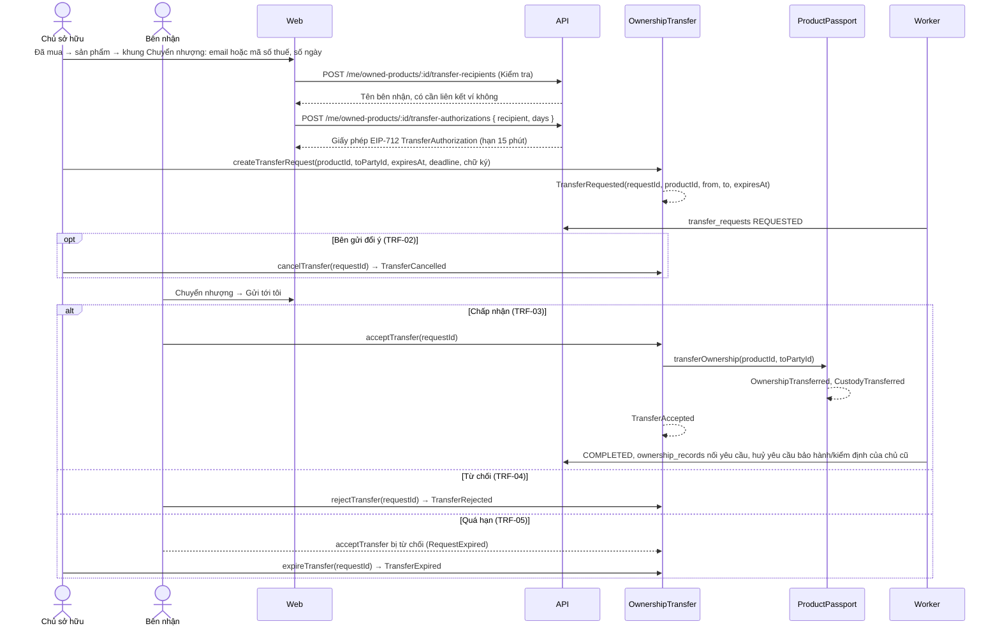

# M9 – Chuyển nhượng quyền sở hữu

Với M9, chủ sở hữu chuyển một sản phẩm đã mua cho người khác hoặc cho một doanh nghiệp. Chủ hiện tại gửi yêu cầu, và quyền sở hữu chỉ đổi khi bên nhận bấm chấp nhận. Mỗi bên tự ký và trả gas bằng ví MetaMask của mình, giống các module trước, và không có ví hệ thống nào gửi giao dịch thay.

| UC     | Tên                                    | Actor                                  | Chạm blockchain                                                          |
| ------ | -------------------------------------- | -------------------------------------- | ------------------------------------------------------------------------ |
| TRF-01 | Gửi yêu cầu chuyển nhượng              | Chủ sở hữu (cá nhân hoặc doanh nghiệp) | `OwnershipTransfer.createTransferRequest`                                |
| TRF-02 | Huỷ yêu cầu khi bên nhận chưa trả lời  | Bên gửi                                | `OwnershipTransfer.cancelTransfer`                                       |
| TRF-03 | Chấp nhận, nhận quyền sở hữu           | Bên nhận                               | `OwnershipTransfer.acceptTransfer` → `ProductPassport.transferOwnership` |
| TRF-04 | Từ chối yêu cầu                        | Bên nhận                               | `OwnershipTransfer.rejectTransfer`                                       |
| TRF-05 | Đóng yêu cầu đã quá hạn                | Bất kỳ ai                              | `OwnershipTransfer.expireTransfer`                                       |
| TRF-06 | Xem yêu cầu gửi tới, đã gửi và đã đóng | Người dùng đăng nhập                   | Không (đọc CSDL do Worker chiếu)                                         |

## 1. Quyết định thiết kế

| Mã  | Quyết định                                                                                                                                                                                                                                                                                                                                                                                                                                                                                                                                                                                                                                                          | Lý do                                                                                                                                                             |
| --- | ------------------------------------------------------------------------------------------------------------------------------------------------------------------------------------------------------------------------------------------------------------------------------------------------------------------------------------------------------------------------------------------------------------------------------------------------------------------------------------------------------------------------------------------------------------------------------------------------------------------------------------------------------------------- | ----------------------------------------------------------------------------------------------------------------------------------------------------------------- |
| D63 | **Contract mới `OwnershipTransfer`**, không thêm hàm vào ProductPassport. Khi bên nhận chấp nhận, contract gọi `ProductPassport.transferOwnership` qua `TRANSFER_CONTRACT_ROLE` (điểm nối đã chuẩn bị ở D45). Contract đọc PartyRegistry để biết ví thuộc bên nào và tổ chức có được duyệt không, đọc ProductPassport để lấy trạng thái và chủ sở hữu, đọc ServiceTicketManager để biết phiếu sửa đang mở. Deploy script cấp role nên **ví deploy phải là Admin** của PartyRegistry.                                                                                                                                                                                | ProductPassport v2 đã deploy và giữ dữ liệu sản phẩm, không thêm hàm được (D38, D45).                                                                             |
| D64 | **Hai bước, mỗi bên một ví.** API kiểm tra bên nhận và thời hạn rồi ký **giấy phép EIP-712 `TransferAuthorization(productId, fromPartyId, toPartyId, expiresAt, deadline)`**, hạn 15 phút. Ví chủ sở hữu gửi `createTransferRequest` với đúng các giá trị đó. Bên nhận chấp nhận hoặc từ chối bằng ví của họ, bước này không cần giấy phép. Quyền sở hữu chỉ đổi trong `acceptTransfer`.                                                                                                                                                                                                                                                                            | Theo lựa chọn của nhóm ("cả hai bên dùng ví riêng"). Giấy phép giữ cho bên nhận đúng là tài khoản trong hệ thống, vì chủ sở hữu không tự điền được partyId tuỳ ý. |
| D65 | **Bên nhận là cá nhân hoặc doanh nghiệp.** Chủ sở hữu nhập email tài khoản cá nhân hoặc mã số thuế của doanh nghiệp đã duyệt, bấm **Kiểm tra** để xem đúng tên rồi mới gửi. Cá nhân chưa liên kết ví vẫn nhận được yêu cầu nhưng phải liên kết ví trước khi chấp nhận. Doanh nghiệp làm chủ thì người đại diện thao tác thay bằng ví cá nhân của mình (`_actsFor`), áp dụng cho cả chấp nhận lẫn chuyển tiếp. Từ M9, "chủ sở hữu" trong API là tập bên của người dùng gồm bên cá nhân và tổ chức người đó đại diện (`OwnerParties`), nên người đại diện của tổ chức đang sở hữu sản phẩm cũng thấy **Đã mua** và gửi được yêu cầu bảo hành (M7) hay kiểm định (M8). | Theo lựa chọn của nhóm ("cả cá nhân và tổ chức"). Tổ chức chỉ có ví của người đại diện, nên phải có một quy tắc chung cho mọi nghiệp vụ của chủ sở hữu.           |
| D66 | **Thời hạn chờ 1–30 ngày, mặc định 7.** `expiresAt` nằm trong giấy phép và được ghi on-chain. Quá hạn thì bên nhận không chấp nhận được (`RequestExpired`) và ai cũng gọi được `expireTransfer`. Nếu chủ tạo yêu cầu mới, yêu cầu quá hạn tự đóng (EXPIRED) trong cùng giao dịch. Hệ thống không có ví chạy định kỳ để đóng yêu cầu, nên API tính cờ `expired` theo giờ máy chủ để web hiện "Quá hạn, chưa đóng" và nút **Đóng yêu cầu hết hạn**.                                                                                                                                                                                                                   | Theo lựa chọn của nhóm. Không cần ví hệ thống (D2), và yêu cầu quá hạn không chặn sản phẩm mãi.                                                                   |
| D67 | **Mỗi sản phẩm tối đa một yêu cầu mở**, on-chain (`activeRequestOf`) và trong CSDL (`ux_transfer_one_active`). Bên gửi huỷ được khi bên nhận chưa trả lời. Huỷ, từ chối và quá hạn đều là giao dịch on-chain có event, để Indexer và cả hai bên thấy cùng một trạng thái.                                                                                                                                                                                                                                                                                                                                                                                           | Tránh hai người cùng chấp nhận một sản phẩm. Gas của huỷ và từ chối nhỏ (mục 6).                                                                                  |
| D68 | **Bảo hành đi theo sản phẩm, nhưng sản phẩm đang sửa thì không chuyển được.** WarrantyManager không đổi gì, nên hạn bảo hành còn lại giữ nguyên cho chủ mới. Khi sản phẩm có phiếu sửa đang mở (`openTicketOf`), contract chặn cả `createTransferRequest` lẫn `acceptTransfer` (`ProductUnderRepair`). Khi đổi chủ, Worker huỷ các yêu cầu bảo hành chưa tiếp nhận và yêu cầu kiểm định đang chờ do chủ cũ gửi.                                                                                                                                                                                                                                                     | Theo lựa chọn của nhóm ("bảo hành đi theo, chặn khi đang sửa"). Chủ mới không phải nhận một yêu cầu mà mình không gửi.                                            |
| D69 | **Worker chiếu 5 event.** `TransferRequested` tạo dòng `transfer_requests` (REQUESTED). Bốn event đóng ghi trạng thái, `closed_at` và `closed_tx_hash`. Hai contract được quét riêng nên thứ tự event giữa chúng không cố định; vì vậy `ownership_records.transfer_request_id` được nối từ cả hai phía (khi chiếu `OwnershipTransferred` thì tìm yêu cầu COMPLETED cùng giao dịch, khi chiếu `TransferAccepted` thì cập nhật bản ghi sở hữu cùng giao dịch). Cảnh báo `TRANSFER_UNKNOWN` khi sản phẩm hay bên trong event không có trong CSDL, hoặc event đóng một yêu cầu không có.                                                                                | Chain là nguồn sự thật, CSDL không lệch âm thầm (D62).                                                                                                            |
| D70 | **Không có migration.** Bảng `transfer_requests` (kèm `ux_transfer_one_active`) và cột `ownership_records.transfer_request_id` đã có từ thiết kế CSDL ban đầu. Hai bên trong cuộc thấy họ tên và email đã che (cá nhân) hoặc tên và mã số thuế (doanh nghiệp). Hộ chiếu công khai chỉ có bước **Chuyển quyền sở hữu** ghi "Người dùng cá nhân", không có tên hay email.                                                                                                                                                                                                                                                                                             | Giữ nguyên dữ liệu của M8. Quyền riêng tư của chủ sở hữu giống M6.                                                                                                |

## 2. Luồng chuyển nhượng



## 3. Bảng traceability

| UC     | Domain Class                     | Database                                                                                                                               | Smart Contract                                                                    | Event                                                         |
| ------ | -------------------------------- | -------------------------------------------------------------------------------------------------------------------------------------- | --------------------------------------------------------------------------------- | ------------------------------------------------------------- |
| TRF-01 | TransferRequest                  | transfer_requests (REQUESTED, expires_at, created_tx_hash)                                                                             | `createTransferRequest(productId, toPartyId, expiresAt, deadline, authorization)` | TransferRequested (và TransferExpired khi tự đóng yêu cầu cũ) |
| TRF-02 | TransferRequest                  | transfer_requests (CANCELLED, closed_at, closed_tx_hash)                                                                               | `cancelTransfer(requestId)`                                                       | TransferCancelled                                             |
| TRF-03 | TransferRequest, OwnershipRecord | transfer_requests (COMPLETED), ownership_records (transfer_request_id), service_requests và inspection_requests của chủ cũ (CANCELLED) | `acceptTransfer(requestId)` → `ProductPassport.transferOwnership`                 | TransferAccepted, OwnershipTransferred, CustodyTransferred    |
| TRF-04 | TransferRequest                  | transfer_requests (REJECTED, closed_at, closed_tx_hash)                                                                                | `rejectTransfer(requestId)`                                                       | TransferRejected                                              |
| TRF-05 | TransferRequest                  | transfer_requests (EXPIRED, closed_at, closed_tx_hash)                                                                                 | `expireTransfer(requestId)`                                                       | TransferExpired                                               |
| TRF-06 | TransferRequest                  | transfer_requests (đọc)                                                                                                                | —                                                                                 | —                                                             |

Điều kiện contract kiểm tra (mỗi điều kiện có ca test):

- Sản phẩm đang ở trạng thái SOLD (`ProductNotSold`).
- Ví gửi là chủ sở hữu, hoặc người đại diện của tổ chức chủ sở hữu đã duyệt (`NotProductOwner`).
- Bên nhận khác chủ hiện tại; nếu bên nhận là tổ chức thì tổ chức đó phải đã được duyệt (`InvalidRecipient`).
- `expiresAt` nằm sau thời điểm hiện tại và không quá 30 ngày (`InvalidExpiry`).
- Sản phẩm chưa có yêu cầu mở còn hạn (`TransferAlreadyActive`) và không có phiếu sửa đang mở (`ProductUnderRepair`).
- Giấy phép do registrar ký, khớp sản phẩm, hai bên, thời hạn, và chưa quá `deadline` (`InvalidAuthorization`, `AuthorizationExpired`).
- Chỉ bên gửi được huỷ (`NotSender`). Chỉ bên nhận được chấp nhận hay từ chối (`NotRecipient`). Yêu cầu phải còn mở (`RequestNotOpen`).
- Chấp nhận khi còn hạn (`RequestExpired`). Chỉ đóng được yêu cầu đã quá hạn (`RequestNotExpired`).

State machine yêu cầu (bảng `TRANSFER_STATE_TRANSITIONS` trong `packages/shared/src/domain/state-machines.ts`):

```text
REQUESTED ──acceptTransfer──▶ COMPLETED
    ├──rejectTransfer───────▶ REJECTED
    ├──cancelTransfer───────▶ CANCELLED
    └──expireTransfer (hoặc tạo yêu cầu mới sau hạn)──▶ EXPIRED
```

## 4. Màn hình

- **Đã mua → chi tiết** có khung **Chuyển nhượng**. Khung gồm ô **Bên nhận** (email hoặc mã số thuế) với nút **Kiểm tra** để hiện đúng tên bên nhận, ô chọn **Thời gian chờ bên nhận** (1–30 ngày) và nút **Gửi yêu cầu chuyển nhượng**. Nếu bên nhận là cá nhân chưa liên kết ví, khung báo người đó phải liên kết ví trước khi chấp nhận. Khi đang có yêu cầu mở, khung hiện thẻ yêu cầu (bên gửi, bên nhận, hạn chấp nhận, giao dịch) kèm nút **Huỷ yêu cầu**. Các yêu cầu đã đóng mà người xem là bên gửi nằm ở cuối khung. Nếu chưa gửi được, khung ghi lý do: chưa có ví, đang có phiếu sửa, đang chờ bên nhận, doanh nghiệp bị khoá…
- **Chuyển nhượng** (`/transfers`, mọi người dùng đăng nhập) có ba tab: **Gửi tới tôi** (nút **Chấp nhận**, **Từ chối**), **Tôi đã gửi** (nút **Huỷ yêu cầu**) và **Đã đóng**. Yêu cầu quá hạn chỉ còn nút **Đóng yêu cầu hết hạn**. Mỗi thao tác hiện tiến trình gửi giao dịch và chờ block finalized.
- **Hộ chiếu công khai** và **Hành trình của sản phẩm** có bước **Chuyển quyền sở hữu** (tab Chuyển nhượng). Nhật ký on-chain có 5 nhãn event mới.

## 5. API

| Phương thức | Đường dẫn                                         | Quyền                                     | Mô tả                                                                                |
| ----------- | ------------------------------------------------- | ----------------------------------------- | ------------------------------------------------------------------------------------ |
| GET         | `/me/owned-products/:id/transfer`                 | Chủ sở hữu hiện tại (hoặc người đại diện) | Yêu cầu đang mở, lý do chưa gửi được (nếu có), các yêu cầu đã đóng do người xem gửi  |
| POST        | `/me/owned-products/:id/transfer-recipients`      | Chủ sở hữu hiện tại                       | `{ recipient }` → partyId, tên bên nhận, `needsWallet` (200)                         |
| POST        | `/me/owned-products/:id/transfer-authorizations`  | Chủ sở hữu hiện tại, có ví                | `{ recipient, days }` → giấy phép `TransferAuthorization` (hạn 15 phút) (201)        |
| GET         | `/me/transfers?filter=INCOMING\|OUTGOING\|CLOSED` | Đăng nhập                                 | Yêu cầu gửi tới, đã gửi, đã đóng của người dùng và tổ chức họ đại diện, đếm theo tab |
| POST        | `/me/transfers/transactions`                      | Đăng nhập, có ví                          | Báo txHash của 5 hàm OwnershipTransfer (202); API theo dõi tới khi finalized         |

## 6. Gas

Đo trên Hardhat (Monad định giá opcode khác; số liệu chính thức ở M13). Web đặt gas limit bằng ước lượng cộng 10%.

| Hàm                                                       | Gas đã dùng       |
| --------------------------------------------------------- | ----------------- |
| `createTransferRequest` (cá nhân gửi)                     | 182.516 – 199.604 |
| `createTransferRequest` (người đại diện gửi thay tổ chức) | 195.326           |
| `acceptTransfer` (bên nhận là cá nhân)                    | 70.214            |
| `acceptTransfer` (người đại diện nhận thay tổ chức)       | 83.022            |
| `rejectTransfer`                                          | 51.614            |
| `cancelTransfer`                                          | 38.803            |
| `expireTransfer`                                          | 31.259            |

Tạo yêu cầu tốn nhiều gas nhất. Phần lớn chi phí đến từ việc kiểm tra chữ ký EIP-712, các lời gọi sang PartyRegistry, ProductPassport và ServiceTicketManager và lưu một bản ghi mới (3 ô bytes32 cộng một ô gói thời gian và trạng thái). Lần tạo đầu tiên của sản phẩm tốn hơn vì các ô lưu trữ còn trống. Chấp nhận rẻ hơn dù có đổi chủ trên ProductPassport, vì không phải kiểm tra chữ ký.

## 7. Test chứng minh

| Test                                                                          | Chứng minh                                                                                                                                                                                                                                                                                                                                                                                                                                                       |
| ----------------------------------------------------------------------------- | ---------------------------------------------------------------------------------------------------------------------------------------------------------------------------------------------------------------------------------------------------------------------------------------------------------------------------------------------------------------------------------------------------------------------------------------------------------------- |
| `packages/contracts/test/transfer/ownership-transfer.test.ts`                 | 10 ca: tạo và chấp nhận (owner, custody đổi, bảo hành giữ nguyên); chuyển cho tổ chức, người đại diện chấp nhận rồi chuyển tiếp; chỉ chủ tạo được và chỉ khi SOLD; bên nhận hợp lệ, giấy phép khoá bên nhận và thời hạn; thời hạn 1–30 ngày, giấy phép quá hạn; một yêu cầu mở, yêu cầu quá hạn tự đóng; chỉ bên gửi huỷ, chỉ bên nhận từ chối; quá hạn thì không chấp nhận được, ai cũng đóng được; phiếu sửa mở và sản phẩm thu hồi; digest khớp `@dpp/shared` |
| `apps/api/src/modules/transfer/domain/transfer-request.spec.ts`               | Yêu cầu còn chờ hay đã quá hạn theo giờ; nhận dạng mã số thuế                                                                                                                                                                                                                                                                                                                                                                                                    |
| `apps/api/src/modules/chain-sync/infrastructure/abi-contract.catalog.spec.ts` | Indexer giải mã TransferRequested, correlation theo requestId, ghi productId, số lớn giữ dạng chuỗi                                                                                                                                                                                                                                                                                                                                                              |
| `apps/api/test/transfer/transfer.e2e-spec.ts`                                 | 5 ca trọn luồng trên Hardhat node: chỉ chủ xem được, tra bên nhận theo email và mã số thuế; tạo và chấp nhận, đổi chủ, bảo hành đi theo, ownership_records nối yêu cầu, yêu cầu bảo hành của chủ cũ bị huỷ; phiếu sửa mở thì không chuyển được; tổ chức từ chối, chủ tự huỷ, rồi tổ chức chấp nhận và người đại diện thao tác thay; quá hạn thì không chấp nhận được, ai cũng đóng được                                                                          |
| `apps/web/src/features/transfer/transfer.spec.ts`                             | Web kiểm tra dữ liệu yêu cầu và giấy phép từ API; nút thao tác đúng theo vai và hạn                                                                                                                                                                                                                                                                                                                                                                              |

## 8. Giới hạn

- Chuyển nhượng không có giá hay thanh toán trên chain. Hai bên tự thoả thuận bên ngoài hệ thống.
- Chưa có thông báo email khi có yêu cầu mới; bên nhận xem ở trang **Chuyển nhượng**.
- Cờ "quá hạn" trên web tính theo giờ máy chủ API. Nếu giờ máy chủ lệch với giờ block, nút có thể hiện sớm hoặc muộn vài giây; contract vẫn là bên quyết định.
- Sản phẩm thu hồi, báo mất hay ngừng sử dụng (M10) không chuyển nhượng được, kể cả yêu cầu đã tạo trước đó.
